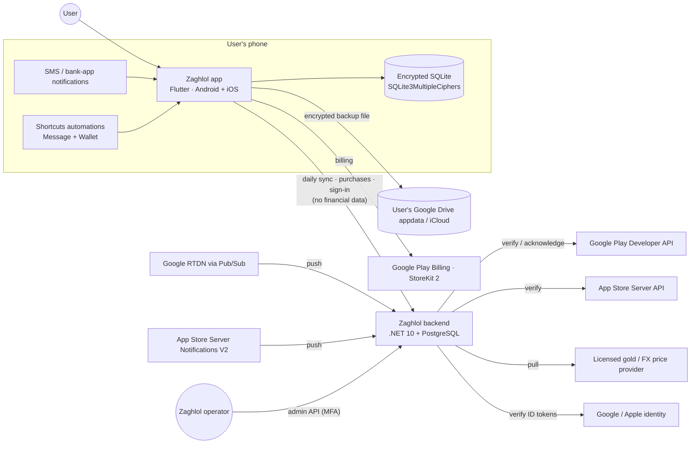

# Zaghlol — System Architecture

| | |
|---|---|
| Document | `docs/03-technical/architecture.md` |
| Version | 0.1 — DRAFT for approval |
| Phase | 3 — Technical specification |
| Inputs | SRS v1.2 (`docs/01-requirements/requirements.md`), approved Phase 2 design (`docs/02-design/`) |
| Decisions | `adr/ADR-001` … `ADR-022` (index in `README.md`) |

---

## 1. Architecture in one paragraph

Zaghlol is an **offline-first Flutter app** whose financial data lives only in an **encrypted on-device SQLite database**. Raw bank messages enter through narrow **native capture adapters**: Android SMS receiver, notification listener and inbox reader; iOS App Intents called by Shortcuts automations; a share extension; OCR; and statement import. A native **Capture Guard** applies the privacy rules (known financial sender? card ignored? OTP or promo?) before anything is written. A **pure-Dart ingestion pipeline** then parses, categorizes, de-duplicates, pairs and persists the message. Everything the user sees is computed locally from that database. A **small .NET 10 + PostgreSQL backend** never sees financial data. It does six jobs:
- registers anonymous installs;
- verifies store purchases and signs entitlements;
- serves a signed merchant/category catalog;
- serves gold and FX prices;
- serves feature flags;
- takes opt-in merchant contributions and "request my bank" counts.

The app makes one daily `sync` call to the backend, plus purchase and sign-in calls when the user acts.

## 2. System context



**Data boundary.** BR-SYNC-03 sets what may cross the phone → backend arrow:
- install ID, platform, app version and catalog version;
- purchase tokens or signed transactions;
- optional ID token;
- opt-in merchant contributions;
- bank-support requests.

Nothing else ever crosses it: no messages, transactions, amounts, balances, budgets, assets, user rules, contacts or location. `security-model.md` §2 states how this is enforced, and `testing-strategy.md` §6 how it is tested.

## 3. Containers & deployment units

| Unit | Technology | Runs where | Responsibility |
|---|---|---|---|
| **Flutter app** | Flutter 3.44+ / Dart 3.12+ (pin the latest stable at Phase 5 start) | Android 8.0+ (API 26), iOS 17+ | UI, domain logic, ingestion pipeline, local DB, backup, purchases UI |
| **Android native capture** | Kotlin: `BroadcastReceiver`, `NotificationListenerService`, WorkManager worker, inbox reader | App process | Receive SMS/notifications, run Capture Guard, write encrypted spool, wake the Dart pipeline |
| **iOS native capture** | Swift: App Intents (`LogBankMessageIntent`, `LogWalletTransactionIntent`), Share Extension, Vision OCR, iCloud adapter | App process / share-extension process | Same Capture Guard + spool; OCR; iCloud file I/O |
| **Home widgets** | Kotlin App Widget (Glance), SwiftUI WidgetKit | Widget process | Show a redacted snapshot written by the app |
| **Backend API** | ASP.NET Core 10 Minimal APIs, EF Core 10, PostgreSQL 17 | Managed container platform (ADR-015) | Public `/v1` API and admin `/admin/v1` API |
| **Backend workers** | .NET `BackgroundService`s in the same image, separate process | Same platform | Price fetch, store-notification processing, entitlement expiry sweep, retention purge, contribution aggregation |
| **Operator CLI** (v1) | .NET global tool `zaghlol-ops` → admin API | Operator laptop, OIDC + MFA | Catalog publish, flags, contributions review, entitlement lookup (D-37: the web admin comes later) |
| **Static catalog CDN** | Object storage + CDN | Provider CDN | Full signed catalog snapshots `catalog-v{n}.json.gz` |

## 4. Mobile app architecture

### 4.1 Layers

Feature-first folders with four layers. Dependencies point inward only.

```
presentation  →  application  →  domain  ←  data
 (widgets,        (use cases,     (pure Dart:    (Drift DAOs, repositories,
  Riverpod         orchestration,  entities,      platform adapters,
  Notifiers)       transactions)   algorithms)    backend client)
```

- **Domain** (`packages/zaghlol_domain`, `packages/zaghlol_parsing`): pure Dart with no Flutter imports. It holds `Money`, entities, the parsing pipeline, categorization, budgeting, transfer pairing, subscriptions, voice-phrase parser, chat engine, Zakah, ROI and net worth. Because it is pure Dart, it is fully unit-testable on the CI host (NFR-MAINT-02) and runs in a background isolate or headless engine.
- **Data**:
  - Drift database and DAOs;
  - repositories implementing the domain's ports (`TransactionRepository`, `CatalogRepository`, …);
  - `BackendClient`;
  - `SecureKeyStore`;
  - platform adapters generated with Pigeon (`platform-channels.md`).
- **Application**: use cases such as `IngestRawMessages`, `ApplyCatalogUpdate`, `BulkEditTransactions`, `RunBackup` and `VerifyPurchase`. Each owns its DB transaction boundaries and emits domain events.
- **Presentation**: screens from `docs/02-design/screens/`, with Riverpod 3 `Notifier`/`AsyncNotifier` view models (ADR-001). No business rules live here.

### 4.2 Module map (component responsibilities)

| Module (`app/lib/features/…`) | Responsibility | Main requirements | Key collaborators |
|---|---|---|---|
| `onboarding` | Welcome, capture setup steppers, scan-results screen S-06, restore entry, "finish setup" | FR-ONB-* | `capture`, `backup` |
| `capture` | Permission state, Capture Guard config writer, inbox scan, spool drain, share/paste intake, setup checker, degraded mode | FR-ING-A-*, FR-ING-I-*, FR-CAP-*, EC-13/14 | native adapters, `ingestion` |
| `ingestion` | Runs the pipeline (`parsing-engine.md`) on raw messages; review queue | FR-PAR-*, FR-ING-A-06, BR-ING-* | `zaghlol_parsing`, `categorization`, `transfers` |
| `accounts` | Cards/accounts, per-currency balances, merge/hide, per-card detail & compare | FR-ACC-*, FR-CARD-* | `transactions` |
| `transactions` | List, search (FTS5), detail, add/edit/delete, bulk edit + undo | FR-TXN-* | `categorization` |
| `categorization` | Categories, merchant rules, catalog lookup, fuzzy matcher, needs-classification queue, contributions outbox | FR-CAT-*, BR-CAT-* | `catalog_sync` |
| `transfers` | Self-transfer pairing, FX conversions, refunds, splits, reimbursements, suggestions | FR-XFR-*, FR-CUR-06, BR-XFR-* | `transactions` |
| `budget` | Payday cycle, budgets per currency, alerts, safe-to-spend, burn line | FR-BUD-*, BR-BUD-* | `notifications` |
| `recurring` | Subscriptions detection, installments, gameya, card dues, reminders | FR-SUB-* | `notifications` |
| `home` | Dashboard per currency, mascot banner selection, feed | FR-HOME-* | most modules (read-only) |
| `insights` | 12 charts, explanations (template engine) | FR-CHT-* | `budget`, `recurring`, `wealth` |
| `mascot` | `ZaghlolAvatar` (Rive state machine) and trigger evaluation | FR-MAS-*, BR-MAS-*, D-35 | — |
| `chat` | Ask Zaghlol intent engine, roast mode | FR-CHAT-* | read models |
| `voice` | Speech capture, Egyptian-number parser, item splitter, monthly counter | FR-VOI-* | `transactions` |
| `wealth` | Assets, prices, net worth snapshots, ≈ conversion | FR-WLT-*, FR-CUR-04/05 | `catalog_sync` (prices) |
| `zakah` *(flag)* | Hawl/nisab engine, ledger | FR-ZAK-* | `wealth` |
| `roi` *(flag)* | General-advice rules (D-38) | FR-ROI-* | `insights` |
| `gold` | Paywall, purchase flow, entitlement verification & cache, gating | FR-GOLD-*, BR-GOLD-* | `backend` |
| `account` | Optional Google/Apple sign-in, link/unlink, delete account | FR-ACCT-* | `backend` |
| `catalog_sync` | Daily sync orchestration: catalog delta, flags, prices, entitlement, outbox upload | FR-SYNC-*, BR-SYNC-* | `backend` |
| `backup` | Snapshot, encrypt, upload/list/restore (Drive appdata / iCloud), schedule, passphrase | FR-BAK-*, BR-BAK-* | `security` |
| `export_import` | CSV/XLSX export, Zaghlol CSV import, PDF & online-bank statement import | FR-EXP-* | `ingestion` |
| `notifications` | Local notifications, quiet hours, lock-screen redaction | FR-NTF-* | — |
| `share_cards` | Achievement image rendering (hide amounts by default) | FR-SHR-* | — |
| `security` | App lock, recents-screenshot hiding, root/jailbreak warning, delete-everything | FR-SEC-*, FR-ONB-08 | — |
| `settings` | All preferences (stored in the `settings` table) | FR-ONB-07 | all |
| `widgets_bridge` | Writes the redacted widget snapshot | FR-WID-* | `home` |

`app/lib/core/` holds the cross-cutting pieces:
- `db/`: Drift database, migrations, key bootstrap;
- `money/`: re-exports domain `Money` and the formatters;
- `l10n/`;
- `theme/`: Mint Fresh and Jade Night tokens;
- `crypto/`: AES-GCM and Argon2id wrappers;
- `platform/`: Pigeon APIs;
- `backend/`: HTTP client, signature verifier;
- `flags/`;
- `result/`: `Result<T, Failure>`;
- `logging/`: redacting local log;
- `routing/`: go_router.

### 4.3 Ingestion data flow (the core path)

```mermaid
sequenceDiagram
  participant OS as Android SMS / Notification<br/>iOS App Intent / Share
  participant G as Native Capture Guard
  participant S as Encrypted spool
  participant W as WorkManager / BGTask /<br/>app foreground
  participant P as Dart pipeline (isolate)
  participant DB as Encrypted DB
  OS->>G: raw text + sender/package + channel + time
  G->>G: known financial sender? OTP/promo? ignore rule (institution+last4+channel)?
  alt dropped
    G-->>OS: discard (nothing written)
  else kept
    G->>S: AES-GCM(entry) with device-bound spool key
    G->>W: schedule expedited work (no payload)
  end
  W->>P: start headless engine / notify foreground isolate
  P->>S: drain entries (decrypt via platform channel)
  P->>P: normalize → match template → extract → classify direction
  P->>P: clean merchant → categorize (rule > catalog > heuristic)
  P->>DB: dedupe (body hash, cross-channel window) → persist txn + raw msg in one DB transaction
  P->>P: pair transfers · merge pending/settled · match refunds · update balances
  P->>DB: commit; then ack spool entries (delete)
  P-->>W: emit events → budget alerts, mascot triggers, local notifications
```

**Why a spool and not direct processing.** An Android `BroadcastReceiver` has about 10 s and must not do heavy work. An iOS App Intent may run while the Flutter engine isn't started. The spool makes capture **idempotent and loss-free** when the process is killed (NFR-REL-01), and the Guard keeps BR-CAP-01 intact: ignored and non-financial messages are discarded *before* the spool. Spool entries are encrypted with a non-exportable key held in Keystore/Keychain and deleted only after the DB commit. ADR-005 covers the alternatives.

**Where the pipeline runs:**

| Situation | Who processes the spool | Latency target |
|---|---|---|
| Android, app in foreground | Receiver notifies a Dart `EventChannel`; the main isolate drains it | < 2 s |
| Android, app killed or background | Expedited WorkManager job starts a headless Flutter engine with the `ingestionMain()` entrypoint | < 10 s (FR-ING-A-01) |
| iOS, Shortcut fires (app not running) | Intent writes the spool and returns a dialog «زغلول سجلها ✓». The spool is drained on next foreground or `BGAppRefreshTask`; a headless-engine attempt is spiked in Phase 5 (SPK-03) | Immediate on next open |
| Android inbox scan (onboarding / re-scan) | Dart pages through `queryInbox` (filtered natively by registry senders) and the Guard runs in Dart on the same rules; no spool | 10k SMS < 60 s (NFR-PERF-03) |
| Share / paste / OCR / statement / voice | In-app path, user confirms before save | — |

### 4.4 Other key flows (summary; details in the referenced docs)

- **Daily sync** (`backend-api.md` §4.2): on foreground, if `now(serverTime) − lastSuccess ≥ 24 h`, the app sends one `POST /v1/sync` carrying versions and the outbox. It verifies the response signature, then atomically applies the catalog delta, flags, prices and entitlement refresh, and re-categorizes only catalog/none-sourced transactions (FR-SYNC-05). Back-off follows BR-SYNC-02.
- **Purchase** (`backend-api.md` §4.3, ADR-012):
  1. The store SDK returns a purchase.
  2. The app calls `POST /v1/purchases/verify`.
  3. The backend verifies with Google/Apple and, on Android, acknowledges.
  4. The backend returns an **ES256-signed entitlement token**, which the app verifies and caches.
  5. If the backend is unreachable, a retry job runs in the background so the Google 3-day acknowledge window is never missed (BR-GOLD-06).
- **Backup/restore** (ADR-011): an encrypted DB snapshot (SQLite backup API into a temp DB with its own key), plus a settings manifest, is streamed through AES-256-GCM chunks under a random backup data key. That key is wrapped by an Argon2id passphrase key in the file header, then uploaded to Drive `appDataFolder` or the iCloud container.
- **Optional sign-in** (ADR-016): a Google/Apple ID token goes to `POST /v1/accounts/signin`, which links the install's entitlements to the account and returns the merged entitlement token.

### 4.5 State management, navigation, DI

- **Riverpod 3** (ADR-001) for DI and state, with code generation (`riverpod_generator`). No global singletons. Repositories are providers, and tests override them.
- **go_router** for navigation per `docs/02-design/03-navigation.md`: shell route with 4 tabs; Add as a modal sheet; deep links for `zaghlol://add`, the widget tap and the Shortcut "open review".
- **Domain events**: an in-process `DomainEventBus` (a stream) that dispatches `TransactionsChanged`, `BudgetThresholdCrossed`, `MascotTrigger`, `CatalogUpdated` and so on, consumed by notifiers and the notification scheduler.

### 4.6 Concurrency & performance

- The DB runs in a Drift background isolate (`NativeDatabase.createInBackground`), so UI frames never wait on SQL.
- Ingestion, inbox scan, catalog apply, backup crypto and chart aggregation run in worker isolates (`Isolate.run`) to meet NFR-PERF-01…04.
- Aggregates are derived **on read**, using SQL with covering indexes and per-cycle cached summaries (`cycle_summaries` table, invalidated by events), not stored redundantly. Chart queries are bounded by period.
- Cold start (< 2 s, NFR-PERF-02): the DB key comes from secure storage → the DB opens → the home summary loads from `cycle_summaries`. The catalog and Rive load lazily.

## 5. Backend architecture

**Modular monolith** (ADR-022): one ASP.NET Core 10 solution, one PostgreSQL database, with clear module boundaries.

| Module | Responsibility | Tables (`backend-schema.md`) | Requirements |
|---|---|---|---|
| `Installs` | Register install, issue install token, last-seen, delete | `installs` | FR-BE-01, FR-ONB-08 |
| `Purchases` | Verify Google/Apple purchases, acknowledge, persist purchase state | `purchases`, `purchase_events` | FR-BE-02, FR-GOLD-02/03 |
| `StoreNotifications` | Ingest RTDN (Pub/Sub push) and ASSN V2; idempotent processing; refresh purchase state | `store_notifications` | FR-BE-03, FR-GOLD-06 |
| `Entitlements` | Compute an install's/account's effective Gold; sign tokens; key rotation | `entitlements` (view), `signing_keys` | FR-GOLD-04, NFR-SEC-05 |
| `Accounts` | Verify Google/Apple ID tokens; link installs & purchases; delete | `accounts`, `account_installs` | FR-BE-09, FR-ACCT-* |
| `Catalog` | Versioned catalog, change log, deltas, full snapshots to CDN, signing | `catalog_*` | FR-BE-06, FR-SYNC-02/04 |
| `Flags` | Flag definitions & targeting rules (platform, min version, percentage) | `feature_flags` | FR-BE-05 |
| `Prices` | Provider adapters, normalization to per-gram karat prices & FX, cache, stale detection, operator override | `price_quotes`, `fx_rates` | FR-BE-04 |
| `Contributions` | Accept, filter (BR-SYNC-04), aggregate by distinct installs, review queue, promote | `merchant_contributions`, `contribution_aggregates` | FR-BE-07 |
| `BankRequests` | Count institution requests per distinct install | `bank_requests` | FR-BE-10 |
| `Sync` | Compose the daily response (catalog + flags + prices + entitlement), sign it | — | FR-SYNC-01/07 |
| `Admin` | Operator API (OIDC + MFA, roles), audit log | `operators`, `audit_log` | FR-BE-08 |
| `Metrics` | Anonymous aggregate counters (daily distinct installs per platform/version) | `daily_active_counts` | OQ-01 (ADR-021) |

The internal layering is `Zaghlol.Api` (endpoints, auth, validation) → `Zaghlol.Application` (handlers) → `Zaghlol.Domain` → `Zaghlol.Infrastructure` (EF Core, store clients, KMS, price providers). Workers reuse the Application layer.

## 6. Integration points

| ID | Integration | Side | Protocol / library | Contract doc | Failure behaviour |
|---|---|---|---|---|---|
| INT-01 | SMS (`SMS_RECEIVED`, `Telephony.Sms` inbox) | Android | Kotlin `BroadcastReceiver`, `ContentResolver` | `platform-channels.md` §2 | Permission missing → degraded mode banner (EC-13) |
| INT-02 | `NotificationListenerService` | Android | Kotlin | §2 | Access revoked → setup checker prompt |
| INT-03 | Share / clipboard | Both | Android intent filter `text/plain`, `image/*`, `application/pdf`; iOS Share Extension | §2, §3 | — |
| INT-04 | Shortcuts App Intents | iOS | AppIntents framework (iOS 17+) | §3 | Missing automation → setup checker (EC-14) |
| INT-05 | Message filter extension | iOS | — | ADR-006 | **Not built**: technically infeasible; change request CR-01 |
| INT-06 | OCR | Both | iOS Vision `VNRecognizeTextRequest`; Android ML Kit Latin + Tesseract Arabic (ADR-009) | §4 | Unsupported language → manual entry |
| INT-07 | Speech | Both | `speech_to_text` plugin → Android `SpeechRecognizer` (on-device API 31+), iOS `SFSpeechRecognizer`/`SpeechAnalyzer` | ADR-010 | No ar-EG on device → message + manual entry (EC-32) |
| INT-08/09 | Play Billing 8 / StoreKit 2 | App | `in_app_purchase` 3.3+ (bundles PBL 8) | `backend-api.md` §4.3 | Pending → "pending"; backend down → retry queue |
| INT-10 | Google Drive v3 `appDataFolder` | App | `google_sign_in` + `googleapis` | ADR-011 | Upload fail → notification «النسخة الاحتياطية ما اتعملتش» (FR-NTF-01) |
| INT-11 | iCloud Documents (ubiquity container) | iOS | Swift `FileManager` ubiquity APIs via Pigeon | §3 | iCloud off → explain, offer Drive |
| INT-12 | Price provider | Backend | HTTPS REST adapter (ADR-014) | — | Stale > 24 h → flagged stale; last value served |
| INT-17 | Zaghlol API | App ↔ BE | HTTPS JSON, ES256-signed responses | `backend-api.md` | App fully usable offline (NFR-BE-01) |
| INT-18 | Google Play Developer API | Backend | `Google.Apis.AndroidPublisher.v3` (service account) | §4.3 | Retry with back-off; purchase stays `verifying` |
| INT-19 | RTDN via Pub/Sub push | Backend | HTTPS push with Google-signed OIDC token | §4.5 | 5xx → Pub/Sub redelivers |
| INT-20 | App Store Server API + ASSN V2 | Backend | JWS (x5c → Apple Root CA G3), REST; community lib `Enjna.AppStoreServerLibrary` or in-house verifier (ADR-012) | §4.5 | Apple retries notifications; daily reconciliation job |
| INT-21 | Sign in with Google / Apple | App + BE | Google ID token (JWKS), Apple ID token (JWKS) + REST token exchange | §4.6 | Sign-in optional; failure keeps local Gold |
| INT-13…16 | Local notifications, biometrics, share sheet, widgets | App | `flutter_local_notifications`, `local_auth`, `share_plus`, `home_widget` | — | — |

## 7. Dependencies (each justified)

App dependencies are pinned in `pubspec.lock`. Versions are the latest stable at Phase 5 start, re-verified then.

| Package | Why we need it | Alternative rejected |
|---|---|---|
| `flutter_riverpod`, `riverpod_annotation`, `riverpod_generator` (3.x) | State + DI (ADR-001) | Bloc, Provider + GetIt |
| `drift`, `drift_dev` (≥ 2.32) + `sqlite3` (3.x) with the `sqlite3mc` build hook | Typed SQL, migrations, FTS5, encryption via SQLite3MultipleCiphers (ADR-002) | `sqflite_sqlcipher` (extra setup), Isar/ObjectBox (no SQL/FTS) |
| `flutter_secure_storage` | DB / backup / spool key storage in Keystore/Keychain, device-only | Custom channel (more native code) |
| `cryptography` + `cryptography_flutter` | AES-256-GCM (hardware-accelerated), Argon2id, ES256 verification | `pointycastle` (slow pure Dart), libsodium bindings (2nd crypto stack) |
| `pigeon` (dev) | Type-safe platform channels | Hand-written MethodChannels |
| `go_router` | Declarative routing, deep links | Navigator 2 by hand |
| `intl` + Flutter gen-l10n | ar-EG / en strings, digits, dates (ADR-017) | `easy_localization` |
| `in_app_purchase` (3.3+, PBL 8) | Play Billing + StoreKit 2 | RevenueCat (OOS-16) |
| `google_sign_in`, `sign_in_with_apple` | Optional sign-in + Drive auth | Firebase Auth (extra SDK, telemetry) |
| `googleapis` | Drive v3 `appDataFolder` | Raw REST |
| `speech_to_text` | Platform speech recognizers, on-device preference | Bundled ASR model (size, Egyptian dialect quality) |
| `flutter_local_notifications` + `timezone` | Local alerts, scheduled reminders | — |
| `local_auth` | Biometrics/passcode app lock | — |
| `rive` (0.14.x) | `ZaghlolAvatar` state machine (D-35) | Lottie (no state machine inputs) |
| `fl_chart` | 12 charts | Syncfusion (licence), custom painters for all |
| `excel` (or `syncfusion_flutter_xlsio` if licensing allows) | `.xlsx` export | — |
| `pdfrx` (PDFium) | Text extraction from bank PDF statements | `syncfusion_flutter_pdf` (licence) |
| `share_plus`, `file_picker` | Share cards, exports, imports | — |
| `home_widget` | Widget snapshot bridge | Custom channel |
| `workmanager` *(not used)* | — | Native WorkManager is configured in Kotlin directly (headless engine control) |

Native-only dependencies:
- **Android:** WorkManager, Glance (widget), ML Kit text recognition (Latin), Tesseract4Android with `ara.traineddata` (about 1.4 MB "fast" model), `com.google.android.play:integrity`. The last is needed for restore attestation (D-45/D-46). It is Google's only first-party attestation and ships through Play services, which Play Billing already requires.
- **iOS:** AppIntents, Vision, WidgetKit, DeviceCheck (`DCAppAttestService`), a system framework used for restore attestation, so it adds no dependency.

**Not used, by policy:** Firebase/Crashlytics/Analytics, any ads SDK, any HTTP interceptor that logs bodies (NFR-PRIV-01).

Backend dependencies:
- ASP.NET Core 10, EF Core 10 + Npgsql;
- `Google.Apis.AndroidPublisher.v3`;
- `Google.Apis.PlayIntegrity.v1`, for `decodeIntegrityToken` (restore attestation; same Google client stack, so no new auth code);
- App Attest attestation/assertion validation: in-house, with `System.Formats.Cbor` + `System.Security.Cryptography` (X.509 chain to the Apple App Attestation Root CA, ES256). Apple ships no .NET library, and this is about 250 lines, reviewed under T-131;
- `Google.Apis.Auth`, for Pub/Sub OIDC and Google ID token verification;
- Apple JWS verification: `Enjna.AppStoreServerLibrary` (MIT, community, last updated 2026-09) **or** an in-house verifier of about 200 lines. ADR-012 decides; the Phase 5 task compares both;
- `Microsoft.IdentityModel.JsonWebTokens` (Apple ID token, our own JWTs);
- `Serilog` + OpenTelemetry exporters;
- `Polly` (retries);
- `FluentValidation`;
- Testcontainers + xUnit for tests.

## 8. NFR → architecture mapping

| NFR | How the architecture meets it |
|---|---|
| NFR-PRIV-01/02/03 | No SDKs with telemetry. Backend API surface limited to the BR-SYNC-03 fields, enforced by request DTO allow-lists and contract tests. |
| NFR-SEC-01/06 | SQLite3MultipleCiphers (AES-256), and *everything* else in the DB: settings, catalog, entitlement cache, outbox. Spool entries and temp files are AES-GCM encrypted (`security-model.md`). |
| NFR-SEC-05 | ES256-signed entitlement verified on device. |
| NFR-REL-01 | Encrypted spool, ack after commit, idempotent dedupe keys. |
| NFR-REL-02 | Drift schema snapshots + generated migration tests; pre-migration encrypted copy. |
| NFR-REL-03 / NFR-BE-01 | Offline-first; backend only improves freshness. |
| NFR-PERF-01…05 | Pure-Dart pipeline compiled AOT; isolates; indexed SQL; per-cycle cached summaries; benchmarks in CI (`testing-strategy.md` §5). |
| NFR-BE-02/03/04 | Stateless API ×2 replicas, managed PostgreSQL with HA; sync delta ≤ 2 KB; full catalog on CDN. |
| NFR-UX-* | Design-system tokens in `core/theme`, `Directionality` from locale, golden tests in both directions and themes. |

## 9. Change requests and items raised by this phase

| ID | Item | Why | Needs |
|---|---|---|---|
| **CR-01** | **Remove FR-ING-I-03 (iOS message filter extension).** | Apple: the extension can't write to containers shared with the app and can't access the network, and it only sees messages from unknown senders. It cannot deliver bank SMS to Zaghlol. Shortcuts Message automations cover the need. | Product-owner approval (D-09 asked for a feasibility study; R-02). |
| **CR-02** | **Android Arabic OCR uses Tesseract** alongside ML Kit. | ML Kit text recognition has no Arabic script. Adds about 1.5 MB. | Accept dependency (ADR-009). |
| **CR-03** | **Backend hosting needs an Egyptian PDPL licence.** Hosting outside Egypt also needs a cross-border permit. | PDPL executive regulations (Decision 816/2025) apply from about 1 Nov 2026. Install IDs, optional account e-mail and truncated IPs are personal data. | Product owner + legal: choose region (ADR-015) and start the PDPC licence application. |
| CR-04 | Minimum OS: Android 8.0 (API 26), target API 36; iOS 17.0 | Answers OQ-03: iOS 17 is the first with Shortcuts automations that run immediately. | Approval with this spec |
| CR-05 | Sign in with Apple on Android uses Apple's web flow through a backend callback | FR-ACCT-01 "if feasible": feasible, at the cost of one extra endpoint. | Approval with this spec |

Open questions that stay with the product owner: OQ-02 (price provider contract, ADR-014 recommends one), OQ-04/OQ-18 (real samples), OQ-05 (merchant seed), OQ-06 (online speech fallback consent; ADR-010 recommends yes with consent), OQ-09/10/11.

## 10. Traceability appendix

Every FR, NFR and BR ID in SRS v1.2 is referenced in this spec. The requirement IDs not named elsewhere in the text are covered as follows.

| Requirement | Covered by |
|---|---|
| BR-CAP-03 (ignore applies to automatic channels; statement import asks to skip ignored cards) | Guard runs only on SMS, notification and Apple Pay channels (platform-channels §1.2). The import summary shows ignored-card rows as "skip" by default (design S-67; `export_import` module). |
| BR-CAP-04 (un-ignore affects future only; Android re-scan) | Ignore rules are evaluated at capture time only; re-scan = `queryInbox` for that sender/card (platform-channels §2) |
| BR-EXP-01 (CSV UTF-8 BOM, ISO 8601, `.` decimal) | `export_import` CSV writer; currency code per row (FR-EXP-07) |
| BR-MON-02 (every amount carries its currency) | `Money` type; every money column paired with a currency column (database-schema conventions) |
| BR-TXN-02 / BR-TXN-03 (income definition; declined excluded) | domain-algorithms §2 (cycle spend excludes declined), §5 (income formula) |
| FR-CUR-01 / FR-CUR-02 (any ISO 4217 currency; primary currency) | Bundled ISO table (domain §1); `settings.primary_currency` orders views, never converts |
| NFR-BE-05 (.NET LTS + PostgreSQL; hosting decided) | §5, ADR-022, ADR-015 |
| NFR-COMP-02 (phones; tablets portrait) | Portrait lock on tablets; no tablet layouts (ADR-019 device matrix) |
| NFR-LEGAL-02/03/04 (IAP for digital goods; disclaimers; trademark review) | In-app purchase only (ADR-012); disclaimers in Zakah/ROI/coaching screens (domain §12–13); bank logos gated by OQ-09 (design 08 §2) |
| NFR-MAINT-01 (templates & seeds as data) | ADR-003, parsing-engine §3, catalog seed asset |
| NFR-PRIV-04 (non-financial SMS never read into storage) | Capture Guard + sender-filtered inbox query (ADR-004/005) |
| NFR-SEC-02 / NFR-SEC-04 / NFR-SEC-07 (authenticated backup; app-switcher snapshot hidden; backend TLS, secrets, MFA, ASVS) | security-model §5, §4.3, §6 |
