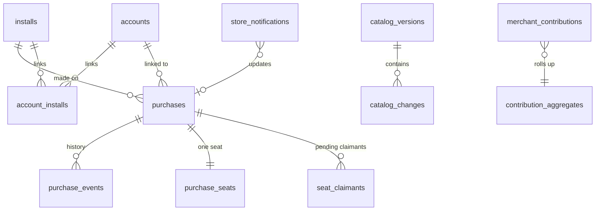

# Backend Data Model (PostgreSQL 17)

**Principle:** the backend stores only what BR-SYNC-03 allows. It holds **no** transactions, messages, amounts, balances, budgets, assets or user rules. Personal data is limited to:
- the pseudonymous install ID;
- the optional account (provider subject ID, plus an e-mail if the provider returns one);
- store purchase identifiers;
- truncated IPs in short-lived logs.

All of it is covered by the retention rules in §4 (NFR-PRIV-06).

Conventions:
- **IDs:** `uuid` (v7) primary keys.
- **Time:** `timestamptz` everywhere.
- **Naming:** snake_case.
- **Migrations:** EF Core, applied by a deploy job.
- **Database roles:** separate roles for API (`app_rw`), workers (`worker_rw`), operators (`ops_ro` + audited `ops_rw` via the admin API only) and migrations (`migrator`).

## 1. ER overview



## 2. Tables

```sql
-- Installs (FR-BE-01)
CREATE TABLE installs (
  id uuid PRIMARY KEY,                         -- generated on device (random, not hardware-derived)
  token_hash bytea NOT NULL,                   -- SHA-256 of the install token issued at registration
  platform text NOT NULL CHECK (platform IN ('android','ios')),
  app_version text NOT NULL,                   -- no OS version: not on the BR-SYNC-03 allow-list (FU-013)
  catalog_version integer NOT NULL DEFAULT 0,
  first_seen_at timestamptz NOT NULL DEFAULT now(),
  last_seen_at timestamptz NOT NULL DEFAULT now(),
  deleted_at timestamptz,                      -- FR-ONB-08 tombstone (row purged after 30 days)
  -- Registration retry (backend-api §4.1, R3-6): no response with a token is ever stored. Both columns are cleared at the
  -- install's first authenticated call or after 24 h; while set, a same-key same-body replay gets a fresh token.
  registration_key_hash bytea,                 -- SHA-256(Idempotency-Key)
  registration_body_sha256 bytea,
  -- iOS seat key registered by this install (backend-api §4.3, R4-1(1), D-62): HMAC-SHA256(K_seat, 'install' || 0x00 ||
  -- installId || publicKey) of element 0 of its first valid seatKeys. Set once, never replaced; a later restore or sign-in
  -- with another element 0 gets 400 SEAT_KEY_MISMATCH. Cleared when the install is tombstoned. Never a raw key.
  seat_key_hash bytea,
  seat_key_trusted boolean NOT NULL DEFAULT false  -- true once the key was registered or sent as element 0 in a verify that passed
                                               -- the store checks or a restore whose App Attest assertion covered it; gates the
                                               -- over-cap sign-in rebind (D-65(a), backend-api §4.3)
);
CREATE INDEX ix_installs_last_seen ON installs(last_seen_at);

-- Optional accounts (FR-ACCT, FR-BE-09)
CREATE TABLE accounts (
  id uuid PRIMARY KEY,
  provider text NOT NULL CHECK (provider IN ('google','apple')),
  provider_subject text NOT NULL,              -- 'sub' claim
  email text,                                  -- only if returned (A-47); support lookup only
  created_at timestamptz NOT NULL DEFAULT now(), last_sign_in_at timestamptz,
  apple_refresh_token_enc bytea,               -- needed to revoke on account deletion (Apple requirement); KMS-encrypted
  UNIQUE (provider, provider_subject)
);
CREATE TABLE account_installs (
  account_id uuid NOT NULL REFERENCES accounts(id) ON DELETE CASCADE,
  install_id uuid NOT NULL REFERENCES installs(id) ON DELETE CASCADE,
  linked_at timestamptz NOT NULL DEFAULT now(),
  PRIMARY KEY (account_id, install_id)
);

-- Purchases (FR-BE-02)
CREATE TABLE purchases (
  id uuid PRIMARY KEY,
  store text NOT NULL CHECK (store IN ('google_play','app_store')),
  product_id text NOT NULL,                    -- zaghlol_gold_monthly | _yearly | _lifetime
  plan text NOT NULL CHECK (plan IN ('monthly','yearly','lifetime')),
  -- Google: purchase token (unique key per Google guidance). Apple: originalTransactionId.
  store_key text NOT NULL,
  linked_purchase_token text,                  -- Google upgrade/downgrade chain
  install_id uuid REFERENCES installs(id) ON DELETE SET NULL,  -- purchasing install (set by verify, never by restore)
  account_id uuid REFERENCES accounts(id) ON DELETE SET NULL,  -- set at sign-in from the buying install or by a support attach; restore never changes it
  account_linked_by text CHECK (account_linked_by IN ('signin','support')),  -- NULL when unlinked; only 'support' links can be detached (§5.3)
  attach_reclaim_used_at timestamptz,          -- D-58: the free account-attach reclaim happened; NEVER cleared, not even when the account is deleted
  dispute_frozen_until timestamptz,            -- D-64/D-65(b): set to now + 30 d by every successful support correction (restarts);
                                               -- while in the future, non-correction support moves and links get 409 ADMIN_CONFLICT
  support_link_notice_pending boolean NOT NULL DEFAULT false,  -- R4-7(2): set by a support attach; cleared once the buying
                                               -- install received supportNotice, or by a detach
  state text NOT NULL CHECK (state IN ('pending','active','in_grace','on_hold','paused','canceled_active','expired','refunded','revoked')),
  expires_at timestamptz,                      -- NULL for lifetime
  acknowledged boolean NOT NULL DEFAULT false, -- Google; must be true within 3 days (BR-GOLD-06)
  environment text NOT NULL CHECK (environment IN ('production','sandbox')),
  obfuscated_install_ref text,                 -- Play obfuscatedAccountId / Apple appAccountToken = hash(install_id)
  last_verified_at timestamptz NOT NULL,
  created_at timestamptz NOT NULL DEFAULT now(),
  UNIQUE (store, store_key),
  CHECK ((account_id IS NULL) = (account_linked_by IS NULL))
);
-- ON DELETE SET NULL on account_id must also clear account_linked_by: done by the account-deletion service in the same
-- transaction (a BEFORE DELETE trigger on accounts enforces it as a backstop).
CREATE INDEX ix_purchases_install ON purchases(install_id);
CREATE INDEX ix_purchases_account ON purchases(account_id);
CREATE INDEX ix_purchases_unacked ON purchases(created_at) WHERE store = 'google_play' AND acknowledged = false;

CREATE TABLE purchase_events (                 -- audit trail of state transitions (no raw receipts)
  id uuid PRIMARY KEY, purchase_id uuid NOT NULL REFERENCES purchases(id) ON DELETE CASCADE,
  from_state text, to_state text NOT NULL, cause text NOT NULL,   -- verify | restore | seat_bind | seat_move:<restore|signin|support|account_attach|verify>
                                                                    -- | seat_rebind:<restore|signin> | seat_rebind_over_cap:<restore|signin>
                                                                    -- | rtdn:<type> | assn:<type> | sweep
  occurred_at timestamptz NOT NULL DEFAULT now()
);

CREATE TABLE store_notifications (             -- FR-BE-03, idempotent ingest
  id uuid PRIMARY KEY,
  store text NOT NULL, external_id text NOT NULL,   -- Pub/Sub messageId | ASSN notificationUUID
  type text NOT NULL,                               -- RTDN notificationType / ASSN notificationType
  subtype text,                                     -- ASSN subtype
  product_id text,                                  -- subscriptionId / sku / productId
  store_key text,                                   -- purchase token (Google) | originalTransactionId (Apple), to re-read state
  environment text CHECK (environment IN ('production','sandbox')),
  event_time timestamptz,                           -- eventTimeMillis / signedDate
  received_at timestamptz NOT NULL DEFAULT now(),
  processed_at timestamptz, attempts integer NOT NULL DEFAULT 0,
  last_error text,                                  -- error code only; never payload text
  payload_digest bytea NOT NULL,                    -- SHA-256 of the received body, for dedupe/forensics
  UNIQUE (store, external_id)
);   -- Only these extracted columns are written, after authentication (backend-api §4.5). The raw envelope is NEVER stored;
     -- fields not listed above (including unknown third-party fields) are not persisted anywhere.

-- Effective entitlement is computed, not stored: view over purchases for an install or account
-- Seat (D-52, FR-GOLD-08, BR-GOLD-07): the ONE install that may hold Gold from a purchase, across platforms (FR-GOLD-07).
-- Exactly one row per purchase (created by the first verify). Every change runs in the verify / restore / sign-in / support
-- transaction under SELECT … FOR UPDATE on this row (backend-api §4.3, §4.6, §5.3).
CREATE TABLE purchase_seats (
  purchase_id uuid PRIMARY KEY REFERENCES purchases(id) ON DELETE CASCADE,
  install_id uuid REFERENCES installs(id) ON DELETE SET NULL,   -- holder; NULL = vacant (install deleted or purged)
  proof text CHECK (proof IN ('binding','attested','basic','account','support','device')), -- how the holder got it; NULL when vacant
  bound_at timestamptz,                               -- when the current holder got the seat
  last_moved_at timestamptz,                          -- exact time of the last move; server-side only, never sent to the app
  next_move_at timestamptz,                           -- ceil_hour(last_moved_at + 30 d); the ONLY value the cooldown check uses and
                                                      -- the only one returned (409, tokens, verify, sign-in) (R3-4). NULL = never moved.
                                                      -- Set by restore/sign-in/verify(plan change) moves, support moves (D-56) and the
                                                      -- account-attach reclaim (D-61(b)). Unchanged by the first bind, a same-holder refresh
                                                      -- and a same-iPhone rebind (D-55). A Google upgrade successor copies its predecessor's.
  device_key_hash bytea,                              -- D-55: HMAC-SHA256(K_seat, purchase_id || seat-key public key) of the holder's
                                                      -- REGISTERED key (installs.seat_key_hash, R4-1(1)); NULL when the holder has
                                                      -- none. KEPT when the seat goes vacant (so "Delete everything" + restore on
                                                      -- the same iPhone is a rebind). Only a seatKeys element at position >= 1 can
                                                      -- match it for a rebind
  device_key_trusted boolean NOT NULL DEFAULT false,  -- copied from the holder's installs.seat_key_trusted when device_key_hash is
                                                      -- written; an over-cap SIGN-IN rebind needs it (restore doesn't)
  recent_rebinds timestamptz[] NOT NULL DEFAULT '{}', -- D-63: times of same-iPhone rebinds in the rolling 30 days; pruned under the
                                                      -- seat lock before each check; at most 2. Over the cap: over-cap rebind that
                                                      -- restarts the window and is never refused (D-65(a)); for sign-in only when
                                                      -- device_key_trusted, otherwise an ordinary move
  CHECK ((install_id IS NULL) = (proof IS NULL)),
  CHECK ((last_moved_at IS NULL) = (next_move_at IS NULL)),
  CHECK (next_move_at IS NULL OR date_trunc('hour', next_move_at) = next_move_at),
  CHECK (cardinality(recent_rebinds) <= 2)
);
CREATE INDEX ix_purchase_seats_install ON purchase_seats(install_id);
-- Invariant (FR-GOLD-08 acceptance): at most one holder per purchase, by construction (primary key).

-- Pending claimants (R3-4, R4-4): installs refused ONLY by the cooldown (they passed attestation, store and account checks),
-- or plan-change payers kept off an account-linked seat by the account rule (verify only; a support move still needs the
-- target to be linked to the account).
-- The only valid support-move targets besides the holder (attach only) and a correction's source install (backend-api §5.3).
CREATE TABLE seat_claimants (
  purchase_id uuid NOT NULL REFERENCES purchases(id) ON DELETE CASCADE,
  install_id uuid NOT NULL REFERENCES installs(id) ON DELETE CASCADE,
  claimed_at timestamptz NOT NULL,                    -- refreshed when the same install is refused again; ignored after 7 days
  channel text NOT NULL CHECK (channel IN ('restore','signin','verify')),
  device_key_hash bytea,                              -- per-purchase hash of the claimant's registered seat key, copied to the seat
                                                      -- by a support move
  PRIMARY KEY (purchase_id, install_id)
);
-- At most 3 rows per purchase: the insert runs under the seat's FOR UPDATE lock and deletes the oldest row when a fourth
-- install is refused. Rows older than 7 days are ignored by every read and deleted by the purger.

-- App Attest keys (iOS restore attestation, ADR-012 Amendment (2026-11-05) Part B). No device identifier is stored (FR-GOLD-09).
CREATE TABLE app_attest_keys (
  key_id bytea PRIMARY KEY,                     -- SHA-256 of the credential public key (= keyId)
  install_id uuid NOT NULL UNIQUE REFERENCES installs(id) ON DELETE CASCADE,  -- one key per install; re-attest replaces it
  public_key bytea NOT NULL, sign_count bigint NOT NULL,
  environment text NOT NULL CHECK (environment IN ('production','development')),
  attested_at timestamptz NOT NULL DEFAULT now()
);

-- Effective entitlement is computed, not stored: purchases whose seat the install holds
-- The entitlement service includes a row with account_id set only when the request carries a valid account token for
-- that account; otherwise the purchase is reported 'paused' (D-61(c)).
CREATE VIEW v_entitlements AS
  SELECT s.install_id, p.id AS purchase_id, p.plan, p.state, p.expires_at, p.store, p.account_id, s.proof, s.next_move_at
  FROM purchase_seats s JOIN purchases p ON p.id = s.purchase_id
  WHERE s.install_id IS NOT NULL AND p.state IN ('active','in_grace','canceled_active');

CREATE TABLE replay_guard (                    -- single-use proofs (ADR-016 amendment 2, ADR-012 Amendment (2026-11-05) Part B)
  key_hash bytea PRIMARY KEY,                   -- SHA-256(nonce claim) | SHA-256(Play Integrity token). Nonces are required for both providers (R2-9)
  kind text NOT NULL CHECK (kind IN ('signin_google','signin_apple','play_integrity')),
  expires_at timestamptz NOT NULL               -- token exp, or +15 min for Play Integrity; rows purged after expiry
);

-- Idempotency (backend-api §1, R2-8, R3-6): verify and sign-in only (registerInstall uses installs.registration_* instead).
-- A stored result is returned only for the same install, operation, key and body, and only while expires_at > now().
CREATE TABLE idempotency_records (
  install_id uuid NOT NULL,                     -- from the install token; no FK, but DELETE /v1/installs/me deletes the rows
  operation_id text NOT NULL CHECK (operation_id IN ('verifyPurchase','signIn')),
  idempotency_key text NOT NULL,                -- ULID from the Idempotency-Key header (CSPRNG random part)
  body_sha256 bytea NOT NULL,                   -- SHA-256 of the request body bytes; a mismatch gives 409 IDEMPOTENCY_KEY_REUSED
  status integer NOT NULL, response_body_enc bytea NOT NULL,  -- final result only (2xx/409/422), KMS-envelope-encrypted (holds tokens)
  account_id uuid,                              -- signIn: the account whose token the stored body holds; DELETE /v1/accounts/me
                                                -- deletes these rows
  expires_at timestamptz NOT NULL,              -- created + 24 h; every lookup requires expires_at > now()
  PRIMARY KEY (install_id, operation_id, idempotency_key)
);
CREATE INDEX ix_idempotency_account ON idempotency_records(account_id) WHERE account_id IS NOT NULL;

CREATE TABLE signing_keys (                    -- metadata; private keys live in the KMS
  kid text PRIMARY KEY, purpose text NOT NULL CHECK (purpose IN ('entitlement','sync')),
  alg text NOT NULL DEFAULT 'ES256', public_jwk jsonb NOT NULL,
  status text NOT NULL CHECK (status IN ('next','active','retired')), activated_at timestamptz, retired_at timestamptz
);

-- Catalog (FR-BE-06, FR-SYNC-02)
CREATE TABLE catalog_versions (
  version integer PRIMARY KEY, published_at timestamptz NOT NULL, published_by uuid NOT NULL,
  notes text, full_snapshot_url text NOT NULL, full_snapshot_sha256 bytea NOT NULL
);
CREATE TABLE catalog_categories (code text PRIMARY KEY, parent_code text REFERENCES catalog_categories(code),
  name_ar text NOT NULL, name_en text NOT NULL, icon text NOT NULL, color text NOT NULL, bucket text NOT NULL,
  sort integer NOT NULL, version integer NOT NULL, deleted boolean NOT NULL DEFAULT false);
CREATE TABLE catalog_merchants (id integer PRIMARY KEY GENERATED ALWAYS AS IDENTITY, canonical text NOT NULL UNIQUE,
  name_ar text, name_en text, category_code text NOT NULL REFERENCES catalog_categories(code),
  version integer NOT NULL, deleted boolean NOT NULL DEFAULT false);
CREATE TABLE catalog_aliases (merchant_id integer NOT NULL REFERENCES catalog_merchants(id), alias_norm text NOT NULL,
  match text NOT NULL, version integer NOT NULL, deleted boolean NOT NULL DEFAULT false, PRIMARY KEY (alias_norm, merchant_id));
CREATE TABLE catalog_keywords (keyword_norm text NOT NULL, lang text NOT NULL, category_code text NOT NULL,
  weight integer NOT NULL, version integer NOT NULL, deleted boolean NOT NULL DEFAULT false, PRIMARY KEY (keyword_norm, lang));
-- Keyword identity is (keyword, lang), the same key the sync `keyword` op uses (FU-009): one category per keyword per language.
-- A delta from version a→b = all rows with version in (a, b], including tombstones (deleted = true).
-- Published versions are immutable; edits happen in a draft workspace (catalog_drafts, not shown) and publish atomically.
-- Draft keys and tombstones: backend-api.md §5.2. A draft DELETE becomes deleted = true at publish; merchant ids come from
-- the identity sequence (allocated by POST /admin/v1/catalog/draft/merchants) and are never reused.

-- Feature flags (FR-BE-05)
CREATE TABLE feature_flags (
  key text PRIMARY KEY,                         -- zakah, smart_roi, roi_named_products, …
  enabled boolean NOT NULL DEFAULT false,
  rules jsonb NOT NULL DEFAULT '{}',            -- {platforms:[], min_app_version:"1.4.0", rollout_percent:0..100}
  version integer NOT NULL, updated_at timestamptz NOT NULL, updated_by uuid NOT NULL
);

-- Prices (FR-BE-04)
CREATE TABLE price_quotes (symbol text NOT NULL, currency text NOT NULL, price numeric(20,6) NOT NULL,
  per_unit text NOT NULL, as_of timestamptz NOT NULL, source text NOT NULL, is_override boolean NOT NULL DEFAULT false,
  override_expires_at timestamptz,              -- set when is_override; default now() + 24 h, at most 7 days; then the feed applies again
  PRIMARY KEY (symbol, currency));
CREATE TABLE fx_rates (base text NOT NULL, quote text NOT NULL, rate numeric(24,12) NOT NULL,
  as_of timestamptz NOT NULL, source text NOT NULL, PRIMARY KEY (base, quote));

-- Contributions (FR-BE-07, BR-SYNC-04)
CREATE TABLE merchant_contributions (
  id uuid PRIMARY KEY,
  merchant_norm text NOT NULL, institution_code text NOT NULL, category_code text NOT NULL,
  install_hash bytea NOT NULL,                  -- HMAC(install_id, pepper) — counts distinct installs without joining
  received_at timestamptz NOT NULL DEFAULT now(),
  UNIQUE (merchant_norm, institution_code, install_hash)
);
CREATE TABLE contribution_aggregates (
  merchant_norm text NOT NULL, institution_code text NOT NULL,
  distinct_installs integer NOT NULL, top_category_code text NOT NULL, category_votes jsonb NOT NULL,
  status text NOT NULL CHECK (status IN ('collecting','ready_for_review','promoted','rejected')),
  reviewed_by uuid, reviewed_at timestamptz,
  PRIMARY KEY (merchant_norm, institution_code)
);   -- ready_for_review when distinct_installs ≥ 5 (A-48); 'collecting' rows are never returned by the admin API

-- "Request my bank" (FR-BE-10)
CREATE TABLE bank_requests (
  institution_name_norm text NOT NULL, country text NOT NULL, channel text NOT NULL CHECK (channel IN ('sms','notification')),
  install_hash bytea NOT NULL, received_at timestamptz NOT NULL DEFAULT now(),
  PRIMARY KEY (institution_name_norm, country, channel, install_hash)
);

-- Anonymous aggregate counters (OQ-01, ADR-021)
CREATE TABLE daily_active_counts (day date NOT NULL, platform text NOT NULL, app_version text NOT NULL,
  installs integer NOT NULL, PRIMARY KEY (day, platform, app_version));

-- Operators & audit (FR-BE-08)
CREATE TABLE operators (id uuid PRIMARY KEY, oidc_subject text NOT NULL UNIQUE, display_name text NOT NULL,
  roles text[] NOT NULL, disabled_at timestamptz);
CREATE TABLE audit_log (id bigint GENERATED ALWAYS AS IDENTITY PRIMARY KEY, operator_id uuid NOT NULL,
  action text NOT NULL, target text NOT NULL, details jsonb NOT NULL, at timestamptz NOT NULL DEFAULT now());
-- Support lookups: target = install id, or 'email:' || hex(HMAC-SHA256(K_audit, NFC(trim(lower(email))))); details.account_id
-- = the matched account. Never the e-mail. Pseudonymous personal data (see §3, §4).
-- Support seat moves and detaches (backend-api §5.3, D-57, FR-BE-11): action IN ('support_seat_move','support_detach'),
-- target = purchase id, details = {from_install, to_install, reason_code, ticket_ref, attached_account_id?, detached_account_id?,
-- corrects_audit_id?, ownership_check: 'order_id', ownership_outcome: pass|fail|unavailable|not_run, outcome}; outcome includes
-- 'dispute_frozen' for a refusal during a D-64 freeze (audited, D-65(b)). Exactly one row per call,
-- naming the operator. Never an e-mail, an ORDER ID or free text. Same 1-year retention as lookups.
```

## 3. Constraints that protect privacy

| Concern | Mechanism |
|---|---|
| Contributions can't contain people or amounts | API validation (BR-SYNC-04 filters, `security-model.md` §6), plus a DB `CHECK (merchant_norm !~ '[0-9]{6,}')` and a length cap of 64 |
| Distinct counts without tracking | `install_hash` = HMAC-SHA256 with a pepper held in the KMS; it can't be joined back to `installs` without the pepper |
| No device identifiers | No column exists for IMEI, ad ID or phone number; DTOs reject unknown fields |
| Purchase link to a person | Store receives `obfuscatedAccountId`/`appAccountToken` = HMAC(install_id), never e-mail |
| Support lookups by e-mail | The e-mail travels only in a POST body (`backend-api.md` §5.2). The audit row stores `HMAC-SHA256(K_audit, NFC(trim(lower(email))))` plus the matched `account_id`, never the e-mail. `K_audit` is a dedicated KMS key, separate from the `install_hash` pepper, so the value can't be reversed by a dictionary attack without the KMS. It is still **pseudonymous personal data** and falls under the audit retention (§4) |
| ID token / attestation replay | `replay_guard` keeps only hashes, until the token's `exp` (Play Integrity: 15 min) |
| Idempotent replays | `idempotency_records` returns a stored result only for the same install, operation, key and body hash, and only while `expires_at > now()`; bodies are encrypted and purged after 24 h, and deleted at once with their install or account. `POST /v1/installs` stores no token-bearing response at all (R3-6) |
| Same-iPhone recognition (D-55, D-62) | Only keyed hashes under `K_seat`, a dedicated KMS key: `purchase_seats.device_key_hash` / `seat_claimants.device_key_hash` = HMAC-SHA256(`K_seat`, purchase_id ‖ public key), and `installs.seat_key_hash` = HMAC-SHA256(`K_seat`, "install" ‖ 0x00 ‖ installId ‖ public key) (R4-1(1)). No raw public key, no Secure Enclave data. At rest, rows for different purchases can't be joined; the per-install hash sits on the install's own row. In transit the raw keys of up to 5 installs of one iPhone are visible to the running API (accepted, D-62); they are never logged |
| Time nonce (R4-2) | No column: the `Zaghlol-Time-Nonce` value is echoed in the signed response and never stored or logged |
| Store order IDs (D-57) | Never stored: no column, no audit field, no log; checked live with the store and dropped |
| Device attestation (D-45) | Only `app_attest_keys` (public key, counter) and Play verdict checks; no device identifier (IMEI, ad ID, serial, phone number) and no verdict payload is stored (FR-GOLD-09) |
| Third-party envelopes | Pub/Sub, ASSN and Apple callback bodies are open, but only the listed fields are read, after authentication. `store_notifications` stores only its explicit extracted columns and `payload_digest`, never the raw envelope or unknown fields |

## 4. Retention (NFR-PRIV-06, A-50)

| Data | Retention | Job |
|---|---|---|
| `installs` inactive (no sync) | 12 months, then deleted (cascades links; purchases keep `install_id = NULL` for store reconciliation) | `RetentionPurger` daily |
| Deleted installs/accounts | Tombstone 30 days, then hard delete | same |
| `store_notifications` | 90 days | same |
| `merchant_contributions` raw rows | Deleted when the aggregate is promoted/rejected, or after 180 days | same |
| `bank_requests` | 24 months (aggregate counts kept) | same |
| Request logs | ≤ 30 days, IPs truncated to /24 (v4) or /48 (v6) | logging pipeline |
| `audit_log`, support-lookup, support-seat-move and support-detach rows (HMAC e-mail pseudonym, install IDs, `account_id`: pseudonymous personal data) | **Exactly 1 year from creation, then deleted** (D-47, FR-BE-11, NFR-PRIV-07). Account deletion neither shortens nor extends it: the row stays until its own 1-year mark (FR-ACCT-04), so it is gone at most 1 year after the account is deleted | `RetentionPurger` daily (`action IN ('support_lookup','support_seat_move','support_detach') AND at < now() - interval '1 year'`) |
| `audit_log`, all other operator actions | 3 years | `RetentionPurger` |
| `replay_guard` | Until `expires_at` | `RetentionPurger` |
| `purchase_seats` | With its purchase. The holder becomes NULL when its install is deleted or purged; `device_key_hash` stays with the seat (D-55) and is deleted with the purchase | — |
| `seat_claimants` | 7 days (ignored after that by every read); deleted with the install | `RetentionPurger` |
| `installs.seat_key_hash` | With the install: cleared at tombstone, deleted with the row | API + `RetentionPurger` |
| `purchase_seats.recent_rebinds`, `purchases.dispute_frozen_until`, `purchases.support_link_notice_pending` | With the purchase; rebind times older than 30 days are pruned on every seat check | — |
| `idempotency_records` | 24 h (never served after `expires_at`); deleted at once with its install or account | `RetentionPurger` + delete endpoints |
| `installs.registration_*` | Cleared at first authenticated call or after 24 h | API + `RetentionPurger` |
| DB backups (PITR) | 14 days | provider |

## 5. Capacity check (NFR-BE-04)

At 500k installs and 100k daily syncs:
- **Data size:** `installs` ≈ 500k × 150 B ≈ 75 MB, `purchases` ≈ 50k rows. Total DB < 1 GB.
- **Load:** peak sync ≈ 100k/day → about 5 req/s average, about 50 req/s at peak. That is comfortably two small API replicas.
