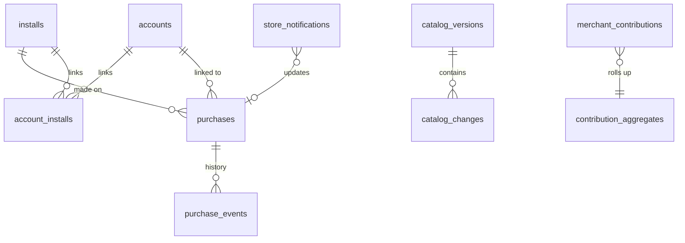

# Backend Data Model (PostgreSQL 17)

**Principle:** the backend stores only what BR-SYNC-03 allows. It holds **no** transactions, messages, amounts, balances, budgets, assets or user rules. Personal data is limited to:
- the pseudonymous install ID;
- the optional account (provider subject ID, plus an e-mail if the provider returns one);
- store purchase identifiers;
- truncated IPs in short-lived logs.

All of it is covered by the retention rules in §4 (NFR-PRIV-06).

Conventions:
- **IDs:** `uuid` (v7) primary keys.
- **Time:** `timestamptz` everywhere.
- **Naming:** snake_case.
- **Migrations:** EF Core, applied by a deploy job.
- **Database roles:** separate roles for API (`app_rw`), workers (`worker_rw`), operators (`ops_ro` + audited `ops_rw` via the admin API only) and migrations (`migrator`).

## 1. ER overview



## 2. Tables

```sql
-- Installs (FR-BE-01)
CREATE TABLE installs (
  id uuid PRIMARY KEY,                         -- generated on device (random, not hardware-derived)
  token_hash bytea NOT NULL,                   -- SHA-256 of the install token issued at registration
  platform text NOT NULL CHECK (platform IN ('android','ios')),
  app_version text NOT NULL,                   -- no OS version: not on the BR-SYNC-03 allow-list (FU-013)
  catalog_version integer NOT NULL DEFAULT 0,
  first_seen_at timestamptz NOT NULL DEFAULT now(),
  last_seen_at timestamptz NOT NULL DEFAULT now(),
  deleted_at timestamptz                       -- FR-ONB-08 tombstone (row purged after 30 days)
);
CREATE INDEX ix_installs_last_seen ON installs(last_seen_at);

-- Optional accounts (FR-ACCT, FR-BE-09)
CREATE TABLE accounts (
  id uuid PRIMARY KEY,
  provider text NOT NULL CHECK (provider IN ('google','apple')),
  provider_subject text NOT NULL,              -- 'sub' claim
  email text,                                  -- only if returned (A-47); support lookup only
  created_at timestamptz NOT NULL DEFAULT now(), last_sign_in_at timestamptz,
  apple_refresh_token_enc bytea,               -- needed to revoke on account deletion (Apple requirement); KMS-encrypted
  UNIQUE (provider, provider_subject)
);
CREATE TABLE account_installs (
  account_id uuid NOT NULL REFERENCES accounts(id) ON DELETE CASCADE,
  install_id uuid NOT NULL REFERENCES installs(id) ON DELETE CASCADE,
  linked_at timestamptz NOT NULL DEFAULT now(),
  PRIMARY KEY (account_id, install_id)
);

-- Purchases (FR-BE-02)
CREATE TABLE purchases (
  id uuid PRIMARY KEY,
  store text NOT NULL CHECK (store IN ('google_play','app_store')),
  product_id text NOT NULL,                    -- zaghlol_gold_monthly | _yearly | _lifetime
  plan text NOT NULL CHECK (plan IN ('monthly','yearly','lifetime')),
  -- Google: purchase token (unique key per Google guidance). Apple: originalTransactionId.
  store_key text NOT NULL,
  linked_purchase_token text,                  -- Google upgrade/downgrade chain
  install_id uuid REFERENCES installs(id) ON DELETE SET NULL,
  account_id uuid REFERENCES accounts(id) ON DELETE SET NULL,
  state text NOT NULL CHECK (state IN ('pending','active','in_grace','on_hold','paused','canceled_active','expired','refunded','revoked')),
  expires_at timestamptz,                      -- NULL for lifetime
  acknowledged boolean NOT NULL DEFAULT false, -- Google; must be true within 3 days (BR-GOLD-06)
  environment text NOT NULL CHECK (environment IN ('production','sandbox')),
  obfuscated_install_ref text,                 -- Play obfuscatedAccountId / Apple appAccountToken = hash(install_id)
  last_verified_at timestamptz NOT NULL,
  created_at timestamptz NOT NULL DEFAULT now(),
  UNIQUE (store, store_key)
);
CREATE INDEX ix_purchases_install ON purchases(install_id);
CREATE INDEX ix_purchases_account ON purchases(account_id);
CREATE INDEX ix_purchases_unacked ON purchases(created_at) WHERE store = 'google_play' AND acknowledged = false;

CREATE TABLE purchase_events (                 -- audit trail of state transitions (no raw receipts)
  id uuid PRIMARY KEY, purchase_id uuid NOT NULL REFERENCES purchases(id) ON DELETE CASCADE,
  from_state text, to_state text NOT NULL, cause text NOT NULL,   -- verify | restore | restore_rebind | rtdn:<type> | assn:<type> | sweep
  occurred_at timestamptz NOT NULL DEFAULT now()
);

CREATE TABLE store_notifications (             -- FR-BE-03, idempotent ingest
  id uuid PRIMARY KEY,
  store text NOT NULL, external_id text NOT NULL,   -- Pub/Sub messageId | ASSN notificationUUID
  type text NOT NULL, received_at timestamptz NOT NULL DEFAULT now(),
  processed_at timestamptz, attempts integer NOT NULL DEFAULT 0, last_error text,
  payload_digest bytea NOT NULL,                    -- SHA-256; raw payload not retained after processing
  UNIQUE (store, external_id)
);

-- Effective entitlement is computed, not stored: view over purchases for an install or account
CREATE VIEW v_entitlements AS
  SELECT COALESCE(p.account_id::text, p.install_id::text) AS subject, p.plan, p.state, p.expires_at, p.store
  FROM purchases p WHERE p.state IN ('active','in_grace','canceled_active');

CREATE TABLE signing_keys (                    -- metadata; private keys live in the KMS
  kid text PRIMARY KEY, purpose text NOT NULL CHECK (purpose IN ('entitlement','sync')),
  alg text NOT NULL DEFAULT 'ES256', public_jwk jsonb NOT NULL,
  status text NOT NULL CHECK (status IN ('next','active','retired')), activated_at timestamptz, retired_at timestamptz
);

-- Catalog (FR-BE-06, FR-SYNC-02)
CREATE TABLE catalog_versions (
  version integer PRIMARY KEY, published_at timestamptz NOT NULL, published_by uuid NOT NULL,
  notes text, full_snapshot_url text NOT NULL, full_snapshot_sha256 bytea NOT NULL
);
CREATE TABLE catalog_categories (code text PRIMARY KEY, parent_code text REFERENCES catalog_categories(code),
  name_ar text NOT NULL, name_en text NOT NULL, icon text NOT NULL, color text NOT NULL, bucket text NOT NULL,
  sort integer NOT NULL, version integer NOT NULL, deleted boolean NOT NULL DEFAULT false);
CREATE TABLE catalog_merchants (id integer PRIMARY KEY GENERATED ALWAYS AS IDENTITY, canonical text NOT NULL UNIQUE,
  name_ar text, name_en text, category_code text NOT NULL REFERENCES catalog_categories(code),
  version integer NOT NULL, deleted boolean NOT NULL DEFAULT false);
CREATE TABLE catalog_aliases (merchant_id integer NOT NULL REFERENCES catalog_merchants(id), alias_norm text NOT NULL,
  match text NOT NULL, version integer NOT NULL, deleted boolean NOT NULL DEFAULT false, PRIMARY KEY (alias_norm, merchant_id));
CREATE TABLE catalog_keywords (keyword_norm text NOT NULL, lang text NOT NULL, category_code text NOT NULL,
  weight integer NOT NULL, version integer NOT NULL, deleted boolean NOT NULL DEFAULT false, PRIMARY KEY (keyword_norm, lang));
-- Keyword identity is (keyword, lang), the same key the sync `keyword` op uses (FU-009): one category per keyword per language.
-- A delta from version a→b = all rows with version in (a, b], including tombstones (deleted = true).
-- Published versions are immutable; edits happen in a draft workspace (catalog_drafts, not shown) and publish atomically.
-- Draft keys and tombstones: backend-api.md §5.2. A draft DELETE becomes deleted = true at publish; merchant ids come from
-- the identity sequence (allocated by POST /admin/v1/catalog/draft/merchants) and are never reused.

-- Feature flags (FR-BE-05)
CREATE TABLE feature_flags (
  key text PRIMARY KEY,                         -- zakah, smart_roi, roi_named_products, …
  enabled boolean NOT NULL DEFAULT false,
  rules jsonb NOT NULL DEFAULT '{}',            -- {platforms:[], min_app_version:"1.4.0", rollout_percent:0..100}
  version integer NOT NULL, updated_at timestamptz NOT NULL, updated_by uuid NOT NULL
);

-- Prices (FR-BE-04)
CREATE TABLE price_quotes (symbol text NOT NULL, currency text NOT NULL, price numeric(20,6) NOT NULL,
  per_unit text NOT NULL, as_of timestamptz NOT NULL, source text NOT NULL, is_override boolean NOT NULL DEFAULT false,
  override_expires_at timestamptz,              -- set when is_override; default now() + 24 h, at most 7 days; then the feed applies again
  PRIMARY KEY (symbol, currency));
CREATE TABLE fx_rates (base text NOT NULL, quote text NOT NULL, rate numeric(24,12) NOT NULL,
  as_of timestamptz NOT NULL, source text NOT NULL, PRIMARY KEY (base, quote));

-- Contributions (FR-BE-07, BR-SYNC-04)
CREATE TABLE merchant_contributions (
  id uuid PRIMARY KEY,
  merchant_norm text NOT NULL, institution_code text NOT NULL, category_code text NOT NULL,
  install_hash bytea NOT NULL,                  -- HMAC(install_id, pepper) — counts distinct installs without joining
  received_at timestamptz NOT NULL DEFAULT now(),
  UNIQUE (merchant_norm, institution_code, install_hash)
);
CREATE TABLE contribution_aggregates (
  merchant_norm text NOT NULL, institution_code text NOT NULL,
  distinct_installs integer NOT NULL, top_category_code text NOT NULL, category_votes jsonb NOT NULL,
  status text NOT NULL CHECK (status IN ('collecting','ready_for_review','promoted','rejected')),
  reviewed_by uuid, reviewed_at timestamptz,
  PRIMARY KEY (merchant_norm, institution_code)
);   -- ready_for_review when distinct_installs ≥ 5 (A-48); 'collecting' rows are never returned by the admin API

-- "Request my bank" (FR-BE-10)
CREATE TABLE bank_requests (
  institution_name_norm text NOT NULL, country text NOT NULL, channel text NOT NULL CHECK (channel IN ('sms','notification')),
  install_hash bytea NOT NULL, received_at timestamptz NOT NULL DEFAULT now(),
  PRIMARY KEY (institution_name_norm, country, channel, install_hash)
);

-- Anonymous aggregate counters (OQ-01, ADR-021)
CREATE TABLE daily_active_counts (day date NOT NULL, platform text NOT NULL, app_version text NOT NULL,
  installs integer NOT NULL, PRIMARY KEY (day, platform, app_version));

-- Operators & audit (FR-BE-08)
CREATE TABLE operators (id uuid PRIMARY KEY, oidc_subject text NOT NULL UNIQUE, display_name text NOT NULL,
  roles text[] NOT NULL, disabled_at timestamptz);
CREATE TABLE audit_log (id bigint GENERATED ALWAYS AS IDENTITY PRIMARY KEY, operator_id uuid NOT NULL,
  action text NOT NULL, target text NOT NULL, details jsonb NOT NULL, at timestamptz NOT NULL DEFAULT now());
```

## 3. Constraints that protect privacy

| Concern | Mechanism |
|---|---|
| Contributions can't contain people or amounts | API validation (BR-SYNC-04 filters, `security-model.md` §6), plus a DB `CHECK (merchant_norm !~ '[0-9]{6,}')` and a length cap of 64 |
| Distinct counts without tracking | `install_hash` = HMAC-SHA256 with a pepper held in the KMS; it can't be joined back to `installs` without the pepper |
| No device identifiers | No column exists for IMEI, ad ID or phone number; DTOs reject unknown fields |
| Purchase link to a person | Store receives `obfuscatedAccountId`/`appAccountToken` = HMAC(install_id), never e-mail |
| Support lookups by e-mail | The e-mail travels only in a POST body (`backend-api.md` §5.2), and `audit_log.details` stores SHA-256 of the lower-cased e-mail, never the e-mail |
| Third-party envelopes | Pub/Sub, ASSN and Apple callback bodies are open, but only the listed fields are read; unlisted fields are never stored (`store_notifications` keeps `payload_digest` only) |

## 4. Retention (NFR-PRIV-06, A-50)

| Data | Retention | Job |
|---|---|---|
| `installs` inactive (no sync) | 12 months, then deleted (cascades links; purchases keep `install_id = NULL` for store reconciliation) | `RetentionPurger` daily |
| Deleted installs/accounts | Tombstone 30 days, then hard delete | same |
| `store_notifications` | 90 days | same |
| `merchant_contributions` raw rows | Deleted when the aggregate is promoted/rejected, or after 180 days | same |
| `bank_requests` | 24 months (aggregate counts kept) | same |
| Request logs | ≤ 30 days, IPs truncated to /24 (v4) or /48 (v6) | logging pipeline |
| `audit_log` | 3 years | — |
| DB backups (PITR) | 14 days | provider |

## 5. Capacity check (NFR-BE-04)

At 500k installs and 100k daily syncs:
- **Data size:** `installs` ≈ 500k × 150 B ≈ 75 MB, `purchases` ≈ 50k rows. Total DB < 1 GB.
- **Load:** peak sync ≈ 100k/day → about 5 req/s average, about 50 req/s at peak. That is comfortably two small API replicas.
