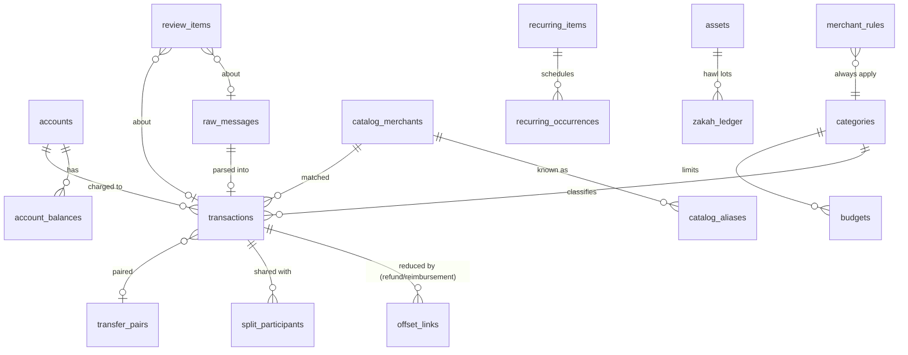

# On-Device Database Schema (Drift + SQLite3MultipleCiphers)

The database file is `zaghlol.db` in the app's private support directory. It is excluded from OS backups (FR-SEC-05) and encrypted from the first write with SQLite3MultipleCiphers. The default cipher is ChaCha20-Poly1305, with the AES-256 SQLCipher-compatible scheme configurable; ADR-002 chooses AES-256 for FR-SEC-01 compliance (`PRAGMA cipher='sqlcipher'; PRAGMA legacy=4`). The 256-bit raw key comes from secure storage (`security-model.md` §3) and is applied with `PRAGMA key = "x'…'"` in Drift's `setup` callback. On open, the app checks `PRAGMA cipher` and refuses to run against an unencrypted file.

**Conventions:**
- **Money:** `*_minor INTEGER NOT NULL` plus a `currency TEXT(3)` ISO 4217 code. The exponent comes from the bundled ISO table (BR-MON-03).
- **Time:** UTC epoch milliseconds, plus a local offset where cycles depend on it.
- **Primary keys:** ULID `TEXT` for user data, `INTEGER` for catalog rows.
- **Soft delete:** `deleted_at` only where Undo needs it.
- **Foreign keys:** `PRAGMA foreign_keys = ON`.
- **Journal:** `PRAGMA journal_mode = WAL` with `synchronous = NORMAL`.

## 1. Entity overview



## 2. Tables

**Schema v2 (T-017)** implements §2.1–2.3 plus the `categories` table of §2.4 (the parent of `transactions.category_id`; T-018 owns its DAO, seeds and the rest of §2.4). The DDL as built is `app/lib/core/db/schema/financial.drift`; the committed dump is `app/drift_schemas/app_database/drift_schema_v2.json`. It is stricter than the sketches below in these ways (all CHECKs, enforced and tested in `test/core/db/financial_schema_constraints_test.dart`):
- every `id TEXT PRIMARY KEY` is also `NOT NULL`; 0/1 flags have `CHECK (x IN (0,1))`;
- **money columns** (T-012): every `*_minor` column has `typeof(x) = 'integer' AND x BETWEEN -(2^53−1) AND 2^53−1` (or `x IS NULL OR (…)`), so the stored value is always an integer in range; `amount_minor`, `original_amount_minor`, `credit_limit_minor` and `share_minor` are ≥ 0, `offset_links.amount_minor` > 0, balances signed; every currency column is `GLOB '[A-Z][A-Z][A-Z]'`; the pair `original_amount_minor`/`original_currency` is both NULL or both set. INTEGER affinity converts a REAL or text value that is losslessly integer-valued (`2.0`, `'123'`, `'12.0'`) to an integer before the CHECK runs, so it is stored as an integer and accepted; a REAL non-integer (`1.5`), non-integral or non-numeric text (`'1.5'`, `'abc'`) and blobs are refused;
- `accounts`: `label` 1–30 characters, `last4` 2–4 ASCII digits (Arabic-Indic digits must be normalised first), `merged_into_id <> id`, `is_default_cash = 1` only for `kind = 'cash'`, and `ux_accounts_default_cash` (partial unique index on `is_default_cash WHERE is_default_cash = 1`) for "exactly one";
- `raw_messages.body_hash` is 64 lowercase hex characters; `transactions.occurred_tz_offset_min` within ±1080; `parse_confidence` NULL or 0..1;
- `transfer_pairs.in_txn_id <> out_txn_id`; `offset_links.expense_txn_id <> source_txn_id`; extra indexes `ix_offset_source`, `ix_split_expense`.

**Schema v4 (T-019), the last batch before features start** ("v1 final"): §2.6–2.8 in `app/lib/core/db/schema/financial_c.drift`; dump `drift_schema_v4.json`; step `core/db/migrations/v4_financial_c.dart`. It also rebuilds four v3 tables with stricter CHECKs (T-018 review n-3, n-4; §4 rule 2c): `catalog_merchants`, `catalog_keywords`, `merchant_rules`, `recurring_items`. Rules for every table v4 creates or rebuilds (tested in `test/core/db/financial_c_constraints_test.dart` by sweeps over every column, and in `schema_audit_test.dart`):
- every INTEGER column is `typeof(x) = 'integer'` (or a 0/1 `IN` list), so a REAL like `1.5` is refused; a rowid alias is an integer by construction;
- every TEXT column other than ids, FK columns, enums and dates refuses NUL, tested on the bytes (`instr(CAST(x AS BLOB), x'00') = 0`): SQLite's `length()` and `GLOB` stop at the first NUL, so `'EGP' || char(0) || 'x'` passes a `GLOB '[A-Z][A-Z][A-Z]'` alone. Enum (`IN`) and date (`date(x) IS x`) CHECKs compare all bytes. Names and senders also refuse C0/C1 control characters;
- **money (T-012 follow-up):** a schema-wide audit checks that every `*_minor` column, old or new, has the integer and ±(2^53−1) CHECK and a registered currency partner, and that a nullable partner has a pair CHECK (`original_*`, `purchase_*` both NULL or both set; `assets.principal_minor`/`manual_value_minor` set ⇒ `assets.currency` set). Where the partner is NOT NULL, a NULL amount means "unknown" (balances). A new money column fails the audit until it is registered there.
- **Not covered (residual):** the v2 tables and the v3 tables not rebuilt (`budgets`, `fired_alerts`, `cycle_summaries`, `catalog_meta`, `catalog_aliases`, `recurring_occurrences`) still accept a REAL in some non-money INTEGER columns (timestamps, `occurred_tz_offset_min`, …) and a NUL after a valid prefix in GLOB-checked text (e.g. a currency). The typed DAOs can't bind a double, and their codes and currencies come from code (`Currency.code`), so only a raw SQL write could store such a value; a later rebuild can close it (FU-075).

### 2.1 Accounts & balances
```sql
CREATE TABLE accounts (
  id TEXT PRIMARY KEY,                       -- ULID
  institution_code TEXT,                     -- registry code; NULL for cash/manual
  kind TEXT NOT NULL CHECK (kind IN ('debit','credit','account','wallet','bnpl','cash','multi_currency')),
  label TEXT NOT NULL,                       -- user-editable, 1–30 chars
  last4 TEXT CHECK (last4 IS NULL OR length(last4) BETWEEN 2 AND 4),
  default_currency TEXT NOT NULL,            -- billing currency of the card/account
  credit_limit_minor INTEGER,                -- credit only (FR-ACC-05)
  statement_due_day INTEGER CHECK (statement_due_day BETWEEN 1 AND 31),
  is_hidden INTEGER NOT NULL DEFAULT 0,
  merged_into_id TEXT REFERENCES accounts(id),
  is_default_cash INTEGER NOT NULL DEFAULT 0,   -- exactly one (FR-ACC-03)
  created_at INTEGER NOT NULL, updated_at INTEGER NOT NULL
);
CREATE UNIQUE INDEX ux_accounts_inst_last4 ON accounts(institution_code, last4) WHERE last4 IS NOT NULL AND merged_into_id IS NULL;

CREATE TABLE account_balances (                -- per currency (FR-ACC-06)
  account_id TEXT NOT NULL REFERENCES accounts(id) ON DELETE CASCADE,
  currency TEXT NOT NULL,
  balance_minor INTEGER,                     -- NULL if unknown
  available_minor INTEGER,                   -- credit: available limit
  as_of INTEGER NOT NULL,                    -- message time (FR-ACC-02)
  source_txn_id TEXT REFERENCES transactions(id) ON DELETE SET NULL,
  PRIMARY KEY (account_id, currency)
);
```

### 2.2 Raw messages, transactions
```sql
CREATE TABLE raw_messages (
  id TEXT PRIMARY KEY,
  channel TEXT NOT NULL CHECK (channel IN ('sms','notification','shortcut_message','apple_pay','share','paste','ocr','pdf','csv')),
  sender TEXT,                               -- SMS address / notification package / Shortcut 'card'
  institution_code TEXT,                     -- resolved by Guard (NULL = generic)
  body TEXT NOT NULL,                        -- encrypted at rest by the DB cipher; never logged
  body_hash TEXT NOT NULL,                   -- SHA-256("zg.raw.v1" ‖ 0x00 ‖ senderKey ‖ 0x00 ‖ hashNorm(body)) hex (T-046 note §3)
  received_at INTEGER NOT NULL,
  sim_slot INTEGER,
  parse_status TEXT NOT NULL CHECK (parse_status IN ('parsed','review','dismissed','reparse_pending')),
  template_id TEXT, template_version INTEGER,
  registry_version INTEGER NOT NULL,         -- enables re-parse after app updates (A-46)
  created_at INTEGER NOT NULL
);
CREATE UNIQUE INDEX ux_raw_body_hash ON raw_messages(body_hash);   -- BR-ING-02 rule 1
-- body_hash (T-046): senderKey = guardSourceKey(channel, source) (folded SMS id, trimmed package); hashNorm is FROZEN
-- (digits to ASCII, ٫/٬, platform-channels §1.2 invisible marks removed, whitespace runs to one space, trim; no case or
-- letter folding; golden vectors), independent of the parser normalizers, so inbox re-scans keep colliding with old rows.
-- The receive time is not hashed. Changing hashNorm requires a migration that re-hashes raw_messages.

CREATE TABLE transactions (
  id TEXT PRIMARY KEY,
  account_id TEXT NOT NULL REFERENCES accounts(id),
  raw_message_id TEXT REFERENCES raw_messages(id) ON DELETE SET NULL,
  source TEXT NOT NULL CHECK (source IN ('sms','notification','shortcut','apple_pay','ocr','pdf','csv','voice','manual','share')),
  direction TEXT NOT NULL CHECK (direction IN ('expense','income','transfer_out','transfer_in','refund','fee')),
  status TEXT NOT NULL CHECK (status IN ('posted','pending','declined','reversed')) DEFAULT 'posted',
  amount_minor INTEGER NOT NULL CHECK (amount_minor >= 0),   -- billed amount, in `currency` (BR-FX-03)
  currency TEXT NOT NULL,
  original_amount_minor INTEGER,             -- e.g. USD 20.00 on an EGP card (FR-TXN-04)
  original_currency TEXT,
  occurred_at INTEGER NOT NULL,              -- from message if present, else received_at (EC-10)
  occurred_tz_offset_min INTEGER NOT NULL,
  merchant_raw TEXT,                         -- as extracted
  merchant_norm TEXT,                        -- normalized key (parsing-engine.md §5)
  catalog_merchant_id INTEGER,               -- soft ref (catalog can change)
  counterparty_kind TEXT CHECK (counterparty_kind IN ('merchant','ipa','phone','person','bank','own_account')),
  counterparty_value TEXT,                   -- IPA / masked phone / name — never uploaded
  category_id TEXT REFERENCES categories(id),
  category_source TEXT NOT NULL CHECK (category_source IN ('user','user_rule','catalog','heuristic','none')),
  is_user_verified INTEGER NOT NULL DEFAULT 0,          -- FR-TXN-02
  transfer_pair_id TEXT REFERENCES transfer_pairs(id) ON DELETE SET NULL,
  is_internal INTEGER NOT NULL DEFAULT 0,               -- excluded from spend/income
  reference_no TEXT,
  balance_after_minor INTEGER,
  template_id TEXT, parse_confidence REAL,
  dedupe_key TEXT,                           -- d1|inst|dir|currency|amount_minor (BR-ING-02 rule 2; last-4 and the ±2 min window are checked in code, T-046 note §3-4)
  note TEXT,
  deleted_at INTEGER,                        -- soft delete for Undo (FR-TXN-06); purged after 30 days
  created_at INTEGER NOT NULL, updated_at INTEGER NOT NULL
);
CREATE INDEX ix_txn_account_time   ON transactions(account_id, occurred_at) WHERE deleted_at IS NULL;
CREATE INDEX ix_txn_category_time  ON transactions(category_id, occurred_at) WHERE deleted_at IS NULL;
CREATE INDEX ix_txn_currency_time  ON transactions(currency, occurred_at, direction) WHERE deleted_at IS NULL;
CREATE INDEX ix_txn_merchant       ON transactions(merchant_norm, occurred_at);
CREATE INDEX ix_txn_dedupe         ON transactions(dedupe_key, occurred_at);
CREATE INDEX ix_txn_category_source ON transactions(category_source) WHERE is_user_verified = 0;   -- FR-SYNC-05

CREATE VIRTUAL TABLE transactions_fts USING fts5(      -- FR-TXN-01 search < 200 ms @ 50k
  merchant, counterparty, note, amount_text,
  content='transactions_fts_src', tokenize='trigram remove_diacritics 1'
);
-- kept in sync by triggers on transactions (insert/update/delete); amount_text = formatted amount in both digit systems
```

**Search as built (T-017).**
- `transactions_fts_src(id INTEGER PRIMARY KEY, txn_id TEXT NOT NULL UNIQUE, merchant, counterparty, note, amount_text NOT NULL)` is a real table: its `INTEGER PRIMARY KEY` keeps the FTS rowids stable across `VACUUM`, which the implicit rowid of `transactions` (a TEXT-PK table) does not.
- Two external-content FTS5 tables over it (`content_rowid='id'`): `transactions_fts` as above, and `transactions_fts_short(merchant, counterparty, tokenize='unicode61 remove_diacritics 2', prefix='1 2')` for 1–2 character queries (T-016 measurement: p95 20.7 ms vs 497 ms for LIKE at 50k rows).
- The view `transactions_fts_row` computes the indexed text: `merchant` = `merchant_raw`, plus `merchant_norm` when it differs; `counterparty` = `counterparty_value`; `amount_text` = the amount with the currency's ISO exponent, Latin then Arabic-Indic digits without grouping (`1250.50 ١٢٥٠٫٥٠`, KWD `1.500 ١٫٥٠٠`, JPY `1200 ١٢٠٠`). The exponent is a `CASE` over the non-2-exponent codes of the bundled ISO table; a test compares it with `Currency.all`, so an ISO refresh that changes an exponent needs a migration that replaces the view.
- Triggers: after insert / update of `id`, merchant, counterparty, note, amount or currency / delete on `transactions` maintain the src row from the view; after insert / update / delete on the src table maintain both FTS tables with the external-content `'delete'` command. Soft-deleted rows stay indexed (Undo); queries filter `deleted_at IS NULL`.
- **FTS5 `secure-delete` (v3, T-018, T-017 review S-2)** is on for `transactions_fts` and `transactions_fts_short`: a deleted row's tokens leave the index segments at once instead of at the next merge. It is an FTS5 option stored in each table's `_config` (data, not schema): set after `createAll` on a fresh database (`core/db/fts_options.dart`) and by the v2 → v3 step; tests check it on fresh and migrated files and that a deleted token's bytes are gone from `_data`. Needs SQLite ≥ 3.44 (the bundled sqlite3mc is 3.54); such a file can't be read by an older FTS5.
- `TransactionsDao.search` trims the query, cuts it to 64 code points, doubles `"` and binds it as one quoted phrase: 3+ characters go to `transactions_fts` (substring), 1–2 to `transactions_fts_short` as a word prefix (`"ab"*`). Digit-only short queries find nothing there; Search should send them to amount filters. Grouping separators in the query (`1,250`) are the search layer's to strip.

### 2.3 Transfers, refunds, splits, reimbursements
```sql
CREATE TABLE transfer_pairs (
  id TEXT PRIMARY KEY,
  out_txn_id TEXT NOT NULL UNIQUE REFERENCES transactions(id) ON DELETE CASCADE,
  in_txn_id  TEXT UNIQUE REFERENCES transactions(id) ON DELETE CASCADE,  -- NULL = one-sided internal (EC-15)
  kind TEXT NOT NULL CHECK (kind IN ('auto','manual','fx_conversion','card_settlement','cross_currency')),
  created_at INTEGER NOT NULL
);

CREATE TABLE offset_links (                    -- reduces an expense's net spend (BR-TXN-01, BR-XFR-03/05)
  id TEXT PRIMARY KEY,
  kind TEXT NOT NULL CHECK (kind IN ('refund','reimbursement')),
  expense_txn_id TEXT NOT NULL REFERENCES transactions(id) ON DELETE CASCADE,
  source_txn_id  TEXT NOT NULL REFERENCES transactions(id) ON DELETE CASCADE,   -- the incoming money
  amount_minor INTEGER NOT NULL CHECK (amount_minor > 0),                       -- same currency as expense
  participant_id TEXT REFERENCES split_participants(id) ON DELETE SET NULL,
  created_at INTEGER NOT NULL,
  UNIQUE (expense_txn_id, source_txn_id)
);
-- invariant (checked in use case + trigger): SUM(amount) per expense ≤ expense.amount (BR-XFR-06);
-- SUM(amount) per source ≤ source.amount (FR-XFR-07)
-- As built (T-017): BEFORE INSERT and BEFORE UPDATE triggers on offset_links, and BEFORE UPDATE OF
-- amount_minor, currency on transactions, RAISE(ABORT, code) with OFFSET_EXCEEDS_EXPENSE,
-- OFFSET_EXCEEDS_SOURCE, OFFSET_CURRENCY_MISMATCH (source currency ≠ expense currency, or a linked
-- transaction's currency changes) or OFFSET_PARTICIPANT_MISMATCH (participant of another expense).
-- v3 (T-018): the currency code is raised only when both transactions exist (a missing one fails the FK,
-- DB_CONSTRAINT_FOREIGN_KEY); trg_split_participant_move (BEFORE UPDATE OF expense_txn_id ON split_participants)
-- raises OFFSET_PARTICIPANT_MISMATCH when a link names the participant; index ix_offset_participant.

CREATE TABLE split_participants (                -- FR-XFR-04/05
  id TEXT PRIMARY KEY,
  expense_txn_id TEXT NOT NULL REFERENCES transactions(id) ON DELETE CASCADE,
  name TEXT NOT NULL, share_minor INTEGER NOT NULL,
  created_at INTEGER NOT NULL
);
```

### 2.4 Categories, catalog, rules

**Schema v3 (T-018)** implements §2.4 (except `categories`, v2) and §2.5 in `app/lib/core/db/schema/financial_b.drift`; dump `drift_schema_v3.json`; step `core/db/migrations/v3_financial_b.dart`. Tightenings (all CHECKs or indexes, tested in `test/core/db/financial_b_constraints_test.dart`):
- **Merchant key** (`catalog_aliases.alias_norm`, `merchant_rules.match_value` when `match_kind = 'merchant_norm'`, `recurring_items.merchant_norm`): exactly the parsing-engine §5 form, 1–64 characters of `[a-z0-9 ]`, no leading, trailing or double space (`^[a-z0-9]+( [a-z0-9]+)*$`); every non-empty T-034 golden key is accepted, and the Dart `isCanonicalMerchantKey` agrees with the CHECK.
- **Category codes** (`catalog_merchants.category_code`, `catalog_keywords.category_code`): OpenAPI `CategoryCode`, `^[a-z][a-z0-9_]{1,31}$`. A soft reference (no FK to `categories.system_code`).
- `catalog_merchants`: `id ≥ 1`, `canonical` 1–200 characters (a display name, not the key), `version ≥ 0`. `catalog_keywords`: `keyword_norm` 1–64 characters without C0/DEL/C1 controls or outer/double spaces (Arabic allowed), `lang` two lowercase letters, `weight` integer 0–100. `catalog_meta`: `version ≥ 0`, `signature_kid` 1–128 characters.
- `catalog_aliases` has an `id INTEGER PRIMARY KEY` and `UNIQUE (alias_norm, merchant_id)` (the identity): the external-content `catalog_alias_fts` (`content_rowid='id'`) needs a rowid that survives `VACUUM`. Triggers after insert / update of `id, alias_norm` / delete keep the FTS in sync (also on the FK cascade from `catalog_merchants`). Upserts must be `ON CONFLICT … DO UPDATE`: `INSERT OR REPLACE` deletes without firing the delete trigger and leaves the index stale. `ix_alias_merchant` for the cascade.
- `merchant_rules`: `catalog_merchant` values are a positive decimal without leading zero (≤ 10 digits); `counterparty` values 1–128 characters without controls. `ix_rules_category`.
- **Trigram candidates** (`CatalogDao.aliasCandidates`): the key must be canonical (else `ArgumentError`, no query); under 3 characters → none; else the OR of its distinct trigrams, each quoted, bound, ranked by `bm25`, default 10, at most 50.
```sql
CREATE TABLE categories (
  id TEXT PRIMARY KEY,                       -- 'sys:groceries' for system, ULID for custom
  system_code TEXT UNIQUE,                   -- from catalog; NULL for custom (Gold)
  parent_id TEXT REFERENCES categories(id),
  name_ar TEXT NOT NULL, name_en TEXT NOT NULL,
  icon TEXT NOT NULL, color TEXT NOT NULL,
  bucket TEXT NOT NULL CHECK (bucket IN ('needs','wants','obligations','savings','income','giving')),
  is_custom INTEGER NOT NULL DEFAULT 0, is_archived INTEGER NOT NULL DEFAULT 0, sort INTEGER NOT NULL
);

CREATE TABLE catalog_merchants (id INTEGER PRIMARY KEY, canonical TEXT NOT NULL, name_ar TEXT, name_en TEXT,
  category_code TEXT NOT NULL, logo_key TEXT, version INTEGER NOT NULL);
CREATE TABLE catalog_aliases (merchant_id INTEGER NOT NULL REFERENCES catalog_merchants(id) ON DELETE CASCADE,
  alias_norm TEXT NOT NULL, match TEXT NOT NULL CHECK (match IN ('exact','prefix','token')), PRIMARY KEY (alias_norm, merchant_id));
CREATE VIRTUAL TABLE catalog_alias_fts USING fts5(alias_norm, content='catalog_aliases', tokenize='trigram');
CREATE TABLE catalog_keywords (keyword_norm TEXT NOT NULL, lang TEXT NOT NULL, category_code TEXT NOT NULL,
  weight INTEGER NOT NULL, PRIMARY KEY (keyword_norm, lang));   -- identity = sync keyword op key (backend-api §5.2)
CREATE TABLE catalog_meta (id INTEGER PRIMARY KEY CHECK (id = 1), version INTEGER NOT NULL,
  applied_at INTEGER NOT NULL, signature_kid TEXT NOT NULL);

CREATE TABLE merchant_rules (                    -- FR-CAT-05/08; never uploaded
  id TEXT PRIMARY KEY,
  match_kind TEXT NOT NULL CHECK (match_kind IN ('catalog_merchant','merchant_norm','counterparty')),
  match_value TEXT NOT NULL,
  category_id TEXT NOT NULL REFERENCES categories(id),
  created_at INTEGER NOT NULL, last_applied_at INTEGER,
  UNIQUE (match_kind, match_value)
);
```

### 2.5 Budgets, recurring, notifications

**As built (T-018):** money columns as in §2 (`typeof = 'integer'`, ±(2^53−1), currency `GLOB '[A-Z][A-Z][A-Z]'`): `budgets.limit_minor` and `recurring_items.amount_minor` ≥ 0, `cycle_summaries.income_minor`/`spend_minor` signed (a cache never refuses a computed value). ISO date columns (`cycle_start`, `next_due_date`, `due_date`) must be real dates (`date(x) IS x`). Also: `budgets.rollover` 0/1, `thresholds` a JSON array (the DAO writes 1–10 distinct percentages in 1..1000), and **`ux_budgets_overall`** (`UNIQUE (currency, period) WHERE category_id IS NULL`): the table's `UNIQUE (category_id, currency, period)` treats NULLs as distinct and would allow two overall budgets. `fired_alerts.kind` a slug `[a-z0-9_]` (1–64), `threshold` integer ≥ 0; "fire once" is the primary key, and `FiredAlertsDao.markFired` answers from the changed-row count (`ON CONFLICT DO NOTHING`), so concurrent callers get exactly one winner. `cycle_summaries.by_category` a JSON object. `recurring_items`: `cadence_days` set iff `cadence = 'custom_days'` (1–3660), `due_day` 1–31, `total_count ≥ 1`, `0 ≤ paid_count ≤ total_count`, `reminder_days` 0–60, `name` 1–60 characters. Indexes `ix_recurring_due` (`next_due_date WHERE status = 'active'`), `ix_recurring_account`, `ix_recurring_occ_txn`.
```sql
CREATE TABLE budgets (
  id TEXT PRIMARY KEY,
  category_id TEXT REFERENCES categories(id),    -- NULL = overall total (A-16)
  currency TEXT NOT NULL,                        -- one currency per budget (FR-BUD-02)
  limit_minor INTEGER NOT NULL CHECK (limit_minor >= 0),
  period TEXT NOT NULL CHECK (period IN ('cycle','annual')),   -- FR-BUD-06
  rollover INTEGER NOT NULL DEFAULT 0,
  thresholds TEXT NOT NULL DEFAULT '[80,100]',   -- JSON
  created_at INTEGER NOT NULL, UNIQUE (category_id, currency, period)
);
CREATE TABLE fired_alerts (                      -- once per threshold per cycle (BR-BUD-02) and other once-only nudges
  kind TEXT NOT NULL, subject_id TEXT NOT NULL, period_key TEXT NOT NULL, threshold INTEGER NOT NULL DEFAULT 0,
  fired_at INTEGER NOT NULL, PRIMARY KEY (kind, subject_id, period_key, threshold)
);
CREATE TABLE cycle_summaries (                   -- read-model cache, invalidated on TransactionsChanged (T-051): cycle_start = cycleKey (ISO date); account_filter '*' or one account id;
                                                 -- by_category = {categoryId: net spend minor}, key '_none' for uncategorized; income/spend are net of offsets (domain-algorithms §2)
  cycle_start TEXT NOT NULL, currency TEXT NOT NULL, account_filter TEXT NOT NULL DEFAULT '*',
  income_minor INTEGER NOT NULL, spend_minor INTEGER NOT NULL, by_category TEXT NOT NULL,   -- JSON
  computed_at INTEGER NOT NULL, PRIMARY KEY (cycle_start, currency, account_filter)
);

CREATE TABLE recurring_items (                   -- FR-SUB-*
  id TEXT PRIMARY KEY,
  kind TEXT NOT NULL CHECK (kind IN ('subscription','installment','card_due','gameya','bill')),
  status TEXT NOT NULL CHECK (status IN ('suggested','active','dismissed','completed')),
  name TEXT NOT NULL, merchant_norm TEXT, account_id TEXT REFERENCES accounts(id),
  amount_minor INTEGER NOT NULL, currency TEXT NOT NULL,
  cadence TEXT NOT NULL CHECK (cadence IN ('monthly','yearly','weekly','custom_days')), cadence_days INTEGER,
  due_day INTEGER, next_due_date TEXT,           -- ISO date, local
  total_count INTEGER, paid_count INTEGER NOT NULL DEFAULT 0,
  reminder_days INTEGER NOT NULL DEFAULT 3, created_at INTEGER NOT NULL
);
CREATE TABLE recurring_occurrences (item_id TEXT NOT NULL REFERENCES recurring_items(id) ON DELETE CASCADE,
  due_date TEXT NOT NULL, txn_id TEXT REFERENCES transactions(id) ON DELETE SET NULL, paid_at INTEGER,
  PRIMARY KEY (item_id, due_date));
```

### 2.6 Wealth, prices, Zakah
```sql
CREATE TABLE assets (                            -- FR-WLT-02 (Gold tier)
  id TEXT PRIMARY KEY,
  type TEXT NOT NULL CHECK (type IN ('gold','gold_coin','certificate','cash','stock_fund','real_estate','car','other')),
  name TEXT NOT NULL,
  currency TEXT,                                 -- money assets
  quantity_milli INTEGER,                        -- grams×1000 for gold; units×1000 for funds
  karat INTEGER CHECK (karat IN (24,22,21,18)),
  principal_minor INTEGER, rate_bp INTEGER, payout TEXT, maturity_date TEXT,
  manual_value_minor INTEGER,                    -- real estate / car / stocks
  acquired_at TEXT, purchase_price_minor INTEGER, purchase_currency TEXT,
  is_liability INTEGER NOT NULL DEFAULT 0, archived_at INTEGER, created_at INTEGER NOT NULL
);
CREATE TABLE price_quotes (symbol TEXT NOT NULL, currency TEXT NOT NULL, price_minor INTEGER NOT NULL,
  per_unit TEXT NOT NULL, as_of INTEGER NOT NULL, source TEXT NOT NULL CHECK (source IN ('backend','manual')),
  PRIMARY KEY (symbol, currency, source));          -- symbols: XAU24_G, XAU21_G, XAU18_G, XAU_COIN8G
CREATE TABLE fx_rates (base TEXT NOT NULL, quote TEXT NOT NULL, rate_e9 INTEGER NOT NULL, as_of INTEGER NOT NULL,
  PRIMARY KEY (base, quote));                        -- 1 base = rate_e9/1e9 quote; display only (BR-FX-01)
CREATE TABLE networth_snapshots (taken_on TEXT NOT NULL, unit TEXT NOT NULL,   -- currency code or 'XAU21_G' …
  assets_minor INTEGER NOT NULL, liabilities_minor INTEGER NOT NULL, PRIMARY KEY (taken_on, unit));
CREATE TABLE zakah_ledger (id TEXT PRIMARY KEY, asset_id TEXT REFERENCES assets(id), lot_start_hijri TEXT NOT NULL,
  due_on TEXT NOT NULL, unit TEXT NOT NULL, amount_minor INTEGER NOT NULL,
  status TEXT NOT NULL CHECK (status IN ('pending','partial','paid')), paid_minor INTEGER NOT NULL DEFAULT 0);
```

**As built (T-019, v4).** Money as in §2 (integer, ±(2^53−1), ISO GLOB, pair rules). A `unit` column (`networth_snapshots`, `zakah_ledger`) holds a currency code or a gold symbol (`XAU` + `[A-Z0-9_]`, 4–16 characters); for a gold unit the amount is **milligrams**, like `quantity_milli`.
- `assets`: `name` 1–60 characters without controls; `karat` only for `gold`/`gold_coin`, and `gold` needs `quantity_milli` (≥ 1) and `karat`; `rate_bp` (0–100 000), `payout` (`monthly`, `quarterly`, `semi_annual`, `annual`, `at_maturity`) and `maturity_date` only for `certificate`; `maturity_date`/`acquired_at` real ISO dates; `principal_minor`/`manual_value_minor` ≥ 0 and in `assets.currency` (`AssetsDao` refuses a Money in another currency with `CurrencyMismatch`, before any SQL); `ix_assets_live (type) WHERE archived_at IS NULL`.
- `price_quotes`: `symbol` a form (1–16 of `[A-Z0-9_]`, starting with a letter), not a closed set, so a new backend symbol can't fail the sync apply; `price_minor` ≥ 1; `per_unit` a slug. `PricesDao.replaceBackendQuotes` swaps the backend rows in one transaction and keeps `manual` ones.
- `fx_rates`: `base <> quote`, `rate_e9` 1..2^53−1.
- `networth_snapshots`: `taken_on` a real ISO date; values signed (a computed history value is never refused).
- `zakah_ledger`: `asset_id` FK **without cascade** (deleting an asset with Zakah history fails, `DB_CONSTRAINT_FOREIGN_KEY`); `lot_start_hijri` `YYYY-MM-DD` with month 01–12, day 01–30 (Hijri, so not checked with `date()`); `due_on` a real Gregorian ISO date; `0 ≤ paid_minor ≤ amount_minor` and the status follows the amounts (`pending` ⇒ 0, `partial` ⇒ between, `paid` ⇒ equal). `ZakahLedgerDao.recordPaid` sets amount and status in one statement. Indexes `ix_zakah_asset`, `ix_zakah_open (due_on) WHERE status <> 'paid'`.

### 2.7 Capture controls, review, Gold templates
```sql
CREATE TABLE ignore_rules (                      -- FR-CAP-*; matched by Guard (institution + last4, never last4 alone — EC-59)
  id TEXT PRIMARY KEY, institution_code TEXT NOT NULL, last4 TEXT,   -- NULL last4 = institution level (FR-CAP-05)
  channel TEXT NOT NULL CHECK (channel IN ('sms','notification','apple_pay')),
  created_at INTEGER NOT NULL, UNIQUE (institution_code, last4, channel)
);
CREATE TABLE capture_senders (                   -- generic-parser senders the user chose to keep (FR-PAR-13, A-66)
  sender TEXT PRIMARY KEY, channel TEXT NOT NULL, confirmed_count INTEGER NOT NULL DEFAULT 0,
  always_capture INTEGER NOT NULL DEFAULT 0, created_at INTEGER NOT NULL
);
CREATE TABLE custom_templates (                  -- FR-PAR-07 (Gold)
  id TEXT PRIMARY KEY, sender TEXT NOT NULL, channel TEXT NOT NULL, template_json TEXT NOT NULL,
  sample_hash TEXT NOT NULL, created_at INTEGER NOT NULL
);
CREATE TABLE review_items (
  id TEXT PRIMARY KEY,
  kind TEXT NOT NULL CHECK (kind IN ('unrecognized','low_confidence','new_sender','needs_category','transfer_ambiguous',
                                     'reimbursement_suggestion','subscription_suggestion','fx_pair_suggestion','payday_suggestion')),
  raw_message_id TEXT REFERENCES raw_messages(id) ON DELETE CASCADE,
  txn_id TEXT REFERENCES transactions(id) ON DELETE CASCADE,
  payload TEXT,                                  -- JSON (candidate ids, suggested fields)
  created_at INTEGER NOT NULL, resolved_at INTEGER, resolution TEXT
);
CREATE INDEX ix_review_open ON review_items(kind, created_at) WHERE resolved_at IS NULL;
```

**As built (T-019, v4).**
- `ignore_rules`: `institution_code` `[a-z0-9_]` 2–32 (OpenAPI `InstitutionCode`); `last4` 2–4 ASCII digits; **`ux_ignore_institution`** (`UNIQUE (institution_code, channel) WHERE last4 IS NULL`), because the table's `UNIQUE` treats NULL `last4` as distinct and would allow two institution-level rules. `CaptureControlsDao.isIgnored` matches the card rule or the institution rule, never last-4 alone (EC-59); `addIgnoreRule` is `ON CONFLICT DO NOTHING` and reports whether it added one.
- `capture_senders`: `sender` 1–128 characters without controls; `channel IN ('sms','notification','shortcut_message')`; `recordConfirmation` is one upsert returning the new count, so concurrent confirmations all count. **T-047 [doc change, FU-096 m-2]:** the primary key stays `sender`; `setAlwaysCapture` and `recordConfirmation` update the row only `WHERE channel = excluded.channel`, so a sender that exists on another channel is reported as a conflict instead of being counted or switched silently. A `(sender, channel)` key (migration) is deferred until a real collision is seen.
- `custom_templates`: `template_json` a JSON object ≤ 64 KiB; `sample_hash` 64 lowercase hex (never the sample); `ix_templates_sender`.
- `review_items`: `payload` NULL or a JSON object ≤ 64 KiB; `resolution` a slug, only with `resolved_at`; FK child indexes `ix_review_raw`, `ix_review_txn`. `ReviewItemsDao.resolve` updates only an open item and reports whether this call resolved it (one winner).

### 2.8 Settings, entitlement, sync, outbox, misc.
```sql
CREATE TABLE settings (key TEXT PRIMARY KEY, value TEXT NOT NULL, updated_at INTEGER NOT NULL);
-- every preference (FR-ONB-07, FR-BAK-06): language, digits, payday_day, income_target, primary_currency,
-- approx_view{enabled,target}, theme, notif.*, quiet_hours, app_lock{enabled,timeout_s}, hide_amounts.*,
-- payday_eras (JSON `[{"from":null|"YYYY-MM-DD","day":1..28}]`, T-051; `payday_day` stays the user-facing value and equals the last era's day),
-- contribution_opt_in, scan_depth_months, capture.scan_personal_senders (T-048, bool, default off), setup_progress, paywall_last_shown, … (typed accessors in core/settings)

CREATE TABLE secure_state (key TEXT PRIMARY KEY, value BLOB NOT NULL, updated_at INTEGER NOT NULL);
-- install_id, install_token, install_registration {installId, Idempotency-Key, body bytes} and install_reregistration (T-141),
-- entitlement_token (signed JWS), account_token, sync_state {last_success_server_time, backoff},
-- feature_flags snapshot, backup schedule & last result. Excluded from backups (FR-BAK-07) except flags-free items.

CREATE TABLE outbox (id TEXT PRIMARY KEY, kind TEXT NOT NULL CHECK (kind IN ('contribution','bank_request','purchase_verify')),
  payload TEXT NOT NULL, created_at INTEGER NOT NULL, attempts INTEGER NOT NULL DEFAULT 0, next_attempt_at INTEGER);
-- turning contribution opt-in off deletes queued 'contribution' rows (EC-48)

CREATE TABLE voice_usage (month TEXT PRIMARY KEY, count INTEGER NOT NULL);     -- 'YYYY-MM' (A-15)
CREATE TABLE undo_batches (id TEXT PRIMARY KEY, created_at INTEGER NOT NULL, description_key TEXT NOT NULL,
  before_json TEXT NOT NULL);                     -- FR-TXN-06 bulk undo; kept 24 h
CREATE TABLE diag_log (id INTEGER PRIMARY KEY, at INTEGER NOT NULL, level TEXT NOT NULL, code TEXT NOT NULL,
  fields TEXT);                                   -- redacted event codes only (error-handling-and-observability.md §3)
```

**As built (T-019, v4).**
- `settings`: `key` 1–64 of `[a-z0-9_.]`; `value` text ≤ 16 KiB. `secure_state`: same key form; `value` must be a BLOB of 1 B–64 KiB. `SecureStateDao.deleteIfEquals(key, expected)` (T-141) deletes only while the value is still `expected`, in one statement. `SecureStateDao.compareAndSet(key, expected, next)` is one conditional statement (insert-if-absent, or update where the value equals `expected`), so of two actors starting from the same value exactly one wins (trusted-time state, T-144). Values never appear in errors (code-only `DbWriteException`).
- `outbox`: `payload` a JSON object ≤ 64 KiB; `attempts ≥ 0`; `ix_outbox_kind (kind, created_at)`. `OutboxDao.deleteKind` serves EC-48.
- `voice_usage`: `month` a real `YYYY-MM`; `count ≥ 0`. `VoiceUsageDao.incrementIfBelow(month, limit)` is one conditional upsert: of 20 racing calls with limit 15, exactly 15 count.
- `undo_batches`: `description_key` an l10n key (`[A-Za-z0-9_.]`, 1–64), `before_json` valid JSON ≤ 8 MiB; `ix_undo_created`.
- `diag_log`: `level IN ('debug','info','warn','error')`; `code` 1–64 of `[A-Za-z0-9_.:-]` (no spaces); `fields` NULL or a JSON object ≤ 2 KiB; `ix_diag_at`. `DiagLogDao.prune` applies the age and row-count limits in one transaction.

## 3. Integrity rules enforced in code (and covered by tests)

| Rule | Where |
|---|---|
| Ignored-card and non-financial messages never reach `raw_messages` | Capture Guard before the spool, plus the Dart pipeline re-checks before insert (defense in depth) |
| A message is stored once; one payment from two channels is one transaction | `ux_raw_body_hash` + `IngestRawMessages`: every dedupe and merge read runs inside the batch's `BEGIN IMMEDIATE` transaction, so the UI and headless connections serialize (T-046 note §4, §10) |
| One default cash account | `AccountsRepository.ensureDefaultCash()` + partial unique index `ux_accounts_default_cash` |
| Overall budget: one per currency and period | partial unique index `ux_budgets_overall` |
| An alert fires once | `fired_alerts` primary key; `FiredAlertsDao.markFired` returns true for exactly one caller |
| Offset sums ≤ amounts | `OffsetLinkService` inside the write transaction; `BEFORE INSERT`/`BEFORE UPDATE` triggers (and one on transaction amount/currency edits) raise `ABORT` with a fixed code |
| A refused write never carries data | DAO writes run through `guardWrite` (`core/db/daos/write_errors.dart`): a `SqliteException` (which holds the statement and its bound values) becomes a code-only `DbWriteException` (`DB_CONSTRAINT_*`, the trigger codes, `DB_WRITE_FAILED`) |
| Transfer pair same currency unless `cross_currency`/`fx_conversion` | `PairSelfTransfers` |
| Catalog update never changes `category_source IN ('user','user_rule')` or `is_user_verified=1` rows | `ApplyCatalogUpdate` WHERE clause (FR-SYNC-05) |
| Money never `REAL` | Drift type converters (`Money`); a lint forbids `double` in money paths |
| One institution-level ignore rule per institution and channel | partial unique index `ux_ignore_institution` |
| Zakah history is never deleted with its asset | `zakah_ledger.asset_id` FK without cascade |
| A secure-state value changes only from the value the writer read | `SecureStateDao.compareAndSet` (one conditional statement) |
| The free voice limit is never exceeded by racing confirms | `VoiceUsageDao.incrementIfBelow` (one conditional upsert) |
| Every money column is integer, bounded and paired with its currency | CHECKs; `test/core/db/schema_audit_test.dart` walks every `*_minor` column |

## 4. Migrations policy

1. Drift `schemaVersion` starts at 1. Every change bumps it and adds a `stepByStep` migration.
2. `drift_dev schema dump` snapshots live in `app/drift_schemas/`, and generated migration tests verify every `vN → vN+1` path *and* `v1 → latest` on populated fixture databases (NFR-REL-02).
2a. T-017: a step runs a **frozen** list of statements (e.g. `core/db/migrations/v2_financial_a.dart`, checked against the dump by a test), never the current schema, so later changes can't leak into old steps. drift_dev 2.35.3's generated `Schema2` (`app_schema.steps.dart`) omits `transactions_fts_src`, `transactions_fts_short` and the view, so it is used for dispatch (`migrationSteps`) only. The codegen script fails on any drift_dev analysis warning (a warning silently drops the entity), and make-migrations refuses a changed schema for an existing version. `schemaShapeOf` compares CHECK clauses too (FU-071 m-3).
2b. T-018: a step that changes an existing trigger drops it by name (no `IF EXISTS`) and re-creates it from the new dump; a test derives the dropped and created lists from the v(N−1) and vN dumps. FTS5 options (data in `_config`) are not in any dump: the current ones live in `core/db/fts_options.dart` (run after `createAll`), and each step that changes them keeps a frozen copy.
   *FTS options on shipped data (T-018 review S-1):* an option such as `secure-delete` affects only later writes. A step that turns on a privacy-relevant FTS option for a database that may already hold user data must also run the table's `'optimize'` (or `'rebuild'`) command, so tokens of rows deleted before the step leave the index too. v3 did not (no v2 file had shipped).
2c. T-019: SQLite can't add a CHECK to an existing table, so a step that tightens one **rebuilds** the table from a frozen list: `CREATE TABLE "<t>__v4"` with the new dump's DDL, `INSERT INTO "<t>__v4" (cols) SELECT cols FROM <t>` (every column by name), a row-count comparison (a mismatch fails the step before anything is dropped), `DROP TABLE <t>`, `ALTER TABLE "<t>__v4" RENAME TO <t>`, then the table's indexes from the dump. Foreign keys are off for the step (children keep their FK text) and the opener's `foreign_key_check` runs before commit. A row that breaks a new CHECK fails the copy, and the opener restores the untouched pre-migration file: nothing is coerced or dropped. A test derives the rebuild list, each temp DDL and the indexes from the v(N−1) and vN dumps.
3. Before running migrations, the app makes an encrypted copy of the DB: `PRAGMA wal_checkpoint(TRUNCATE)`, then a byte copy `zaghlol.db` → `zaghlol.db.migrate.part` → renamed `zaghlol.db.migrate.tmp` (same key and salt by construction; T-016 — `VACUUM INTO` can't run inside drift's migration transaction and its key semantics under sqlite3mc are unproven). It is deleted after success; on failure, or at the next start if the migration was never confirmed, the app restores it and shows the "update failed" screen.
4. Migrations are additive in a release. Column drops or renames happen in two releases: shadow column first, then drop.
5. The registry and catalog are **data**, not schema. Their versions are stored in `catalog_meta` and `raw_messages.registry_version`, and re-parse jobs are driven by version bumps.
6. A backup records `schemaVersion`. Restore refuses files from a newer schema (EC-26) and migrates older ones.
   *As built (T-149):* the snapshot carries every table except the device tables (`db_meta`, `secure_state`, `outbox`, `diag_log`, `catalog_*`; list in `features/backup/application/snapshot_tables.dart`, a test makes every new table pick a side). Restore keeps the target's device tables, writes the restored key slot (`secure_state backup.key_slot.v1`) and sets `db_meta` `restore_regrant_due = 1` (FR-BAK-07 re-grant prompt, cleared by the UI that shows it) and `restore_catalog_resync_due = 1` (catalog sync). The live file is replaced by one SQLite backup transaction; the reserved `zaghlol.db.restore.tmp` name is not used (staging lives in `<temp>/zaghlol_backup_work/`).

## 5. Sizing

| Item | Estimate (power user, 2 years) |
|---|---|
| Transactions | ≈ 20k rows (≈ 4 MB incl. indexes) |
| Raw messages | ≈ 25k (≈ 6 MB) |
| Catalog | ≈ 5k merchants / 20k aliases (≈ 3 MB) |
| FTS indexes | ≈ 4 MB |
| **Total** | **≈ 20 MB**: well within SQLite limits; NFR-PERF-04 queries are bounded by period and indexed |
