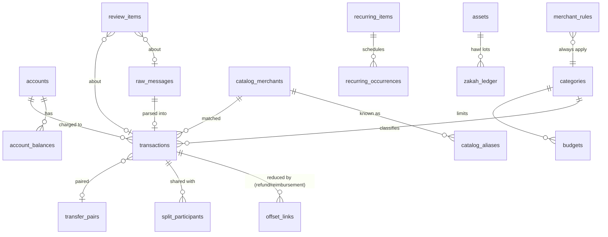

# On-Device Database Schema (Drift + SQLite3MultipleCiphers)

The database file is `zaghlol.db` in the app's private support directory. It is excluded from OS backups (FR-SEC-05) and encrypted from the first write with SQLite3MultipleCiphers. The default cipher is ChaCha20-Poly1305, with the AES-256 SQLCipher-compatible scheme configurable; ADR-002 chooses AES-256 for FR-SEC-01 compliance (`PRAGMA cipher='sqlcipher'; PRAGMA legacy=4`). The 256-bit raw key comes from secure storage (`security-model.md` §3) and is applied with `PRAGMA key = "x'…'"` in Drift's `setup` callback. On open, the app checks `PRAGMA cipher` and refuses to run against an unencrypted file.

**Conventions:**
- **Money:** `*_minor INTEGER NOT NULL` plus a `currency TEXT(3)` ISO 4217 code. The exponent comes from the bundled ISO table (BR-MON-03).
- **Time:** UTC epoch milliseconds, plus a local offset where cycles depend on it.
- **Primary keys:** ULID `TEXT` for user data, `INTEGER` for catalog rows.
- **Soft delete:** `deleted_at` only where Undo needs it.
- **Foreign keys:** `PRAGMA foreign_keys = ON`.
- **Journal:** `PRAGMA journal_mode = WAL` with `synchronous = NORMAL`.

## 1. Entity overview



## 2. Tables

### 2.1 Accounts & balances
```sql
CREATE TABLE accounts (
  id TEXT PRIMARY KEY,                       -- ULID
  institution_code TEXT,                     -- registry code; NULL for cash/manual
  kind TEXT NOT NULL CHECK (kind IN ('debit','credit','account','wallet','bnpl','cash','multi_currency')),
  label TEXT NOT NULL,                       -- user-editable, 1–30 chars
  last4 TEXT CHECK (last4 IS NULL OR length(last4) BETWEEN 2 AND 4),
  default_currency TEXT NOT NULL,            -- billing currency of the card/account
  credit_limit_minor INTEGER,                -- credit only (FR-ACC-05)
  statement_due_day INTEGER CHECK (statement_due_day BETWEEN 1 AND 31),
  is_hidden INTEGER NOT NULL DEFAULT 0,
  merged_into_id TEXT REFERENCES accounts(id),
  is_default_cash INTEGER NOT NULL DEFAULT 0,   -- exactly one (FR-ACC-03)
  created_at INTEGER NOT NULL, updated_at INTEGER NOT NULL
);
CREATE UNIQUE INDEX ux_accounts_inst_last4 ON accounts(institution_code, last4) WHERE last4 IS NOT NULL AND merged_into_id IS NULL;

CREATE TABLE account_balances (                -- per currency (FR-ACC-06)
  account_id TEXT NOT NULL REFERENCES accounts(id) ON DELETE CASCADE,
  currency TEXT NOT NULL,
  balance_minor INTEGER,                     -- NULL if unknown
  available_minor INTEGER,                   -- credit: available limit
  as_of INTEGER NOT NULL,                    -- message time (FR-ACC-02)
  source_txn_id TEXT REFERENCES transactions(id) ON DELETE SET NULL,
  PRIMARY KEY (account_id, currency)
);
```

### 2.2 Raw messages, transactions
```sql
CREATE TABLE raw_messages (
  id TEXT PRIMARY KEY,
  channel TEXT NOT NULL CHECK (channel IN ('sms','notification','shortcut_message','apple_pay','share','paste','ocr','pdf','csv')),
  sender TEXT,                               -- SMS address / notification package / Shortcut 'card'
  institution_code TEXT,                     -- resolved by Guard (NULL = generic)
  body TEXT NOT NULL,                        -- encrypted at rest by the DB cipher; never logged
  body_hash TEXT NOT NULL,                   -- SHA-256(sender ‖ normalized body) hex
  received_at INTEGER NOT NULL,
  sim_slot INTEGER,
  parse_status TEXT NOT NULL CHECK (parse_status IN ('parsed','review','dismissed','reparse_pending')),
  template_id TEXT, template_version INTEGER,
  registry_version INTEGER NOT NULL,         -- enables re-parse after app updates (A-46)
  created_at INTEGER NOT NULL
);
CREATE UNIQUE INDEX ux_raw_body_hash ON raw_messages(body_hash);   -- BR-ING-02 rule 1

CREATE TABLE transactions (
  id TEXT PRIMARY KEY,
  account_id TEXT NOT NULL REFERENCES accounts(id),
  raw_message_id TEXT REFERENCES raw_messages(id) ON DELETE SET NULL,
  source TEXT NOT NULL CHECK (source IN ('sms','notification','shortcut','apple_pay','ocr','pdf','csv','voice','manual','share')),
  direction TEXT NOT NULL CHECK (direction IN ('expense','income','transfer_out','transfer_in','refund','fee')),
  status TEXT NOT NULL CHECK (status IN ('posted','pending','declined','reversed')) DEFAULT 'posted',
  amount_minor INTEGER NOT NULL CHECK (amount_minor >= 0),   -- billed amount, in `currency` (BR-FX-03)
  currency TEXT NOT NULL,
  original_amount_minor INTEGER,             -- e.g. USD 20.00 on an EGP card (FR-TXN-04)
  original_currency TEXT,
  occurred_at INTEGER NOT NULL,              -- from message if present, else received_at (EC-10)
  occurred_tz_offset_min INTEGER NOT NULL,
  merchant_raw TEXT,                         -- as extracted
  merchant_norm TEXT,                        -- normalized key (parsing-engine.md §5)
  catalog_merchant_id INTEGER,               -- soft ref (catalog can change)
  counterparty_kind TEXT CHECK (counterparty_kind IN ('merchant','ipa','phone','person','bank','own_account')),
  counterparty_value TEXT,                   -- IPA / masked phone / name — never uploaded
  category_id TEXT REFERENCES categories(id),
  category_source TEXT NOT NULL CHECK (category_source IN ('user','user_rule','catalog','heuristic','none')),
  is_user_verified INTEGER NOT NULL DEFAULT 0,          -- FR-TXN-02
  transfer_pair_id TEXT REFERENCES transfer_pairs(id) ON DELETE SET NULL,
  is_internal INTEGER NOT NULL DEFAULT 0,               -- excluded from spend/income
  reference_no TEXT,
  balance_after_minor INTEGER,
  template_id TEXT, parse_confidence REAL,
  dedupe_key TEXT,                           -- inst|last4|dir|amount|currency|minute-bucket (BR-ING-02 rule 2)
  note TEXT,
  deleted_at INTEGER,                        -- soft delete for Undo (FR-TXN-06); purged after 30 days
  created_at INTEGER NOT NULL, updated_at INTEGER NOT NULL
);
CREATE INDEX ix_txn_account_time   ON transactions(account_id, occurred_at) WHERE deleted_at IS NULL;
CREATE INDEX ix_txn_category_time  ON transactions(category_id, occurred_at) WHERE deleted_at IS NULL;
CREATE INDEX ix_txn_currency_time  ON transactions(currency, occurred_at, direction) WHERE deleted_at IS NULL;
CREATE INDEX ix_txn_merchant       ON transactions(merchant_norm, occurred_at);
CREATE INDEX ix_txn_dedupe         ON transactions(dedupe_key, occurred_at);
CREATE INDEX ix_txn_category_source ON transactions(category_source) WHERE is_user_verified = 0;   -- FR-SYNC-05

CREATE VIRTUAL TABLE transactions_fts USING fts5(      -- FR-TXN-01 search < 200 ms @ 50k
  merchant, counterparty, note, amount_text,
  content='transactions_fts_src', tokenize='trigram remove_diacritics 1'
);
-- kept in sync by triggers on transactions (insert/update/delete); amount_text = formatted amount in both digit systems
```

### 2.3 Transfers, refunds, splits, reimbursements
```sql
CREATE TABLE transfer_pairs (
  id TEXT PRIMARY KEY,
  out_txn_id TEXT NOT NULL UNIQUE REFERENCES transactions(id) ON DELETE CASCADE,
  in_txn_id  TEXT UNIQUE REFERENCES transactions(id) ON DELETE CASCADE,  -- NULL = one-sided internal (EC-15)
  kind TEXT NOT NULL CHECK (kind IN ('auto','manual','fx_conversion','card_settlement','cross_currency')),
  created_at INTEGER NOT NULL
);

CREATE TABLE offset_links (                    -- reduces an expense's net spend (BR-TXN-01, BR-XFR-03/05)
  id TEXT PRIMARY KEY,
  kind TEXT NOT NULL CHECK (kind IN ('refund','reimbursement')),
  expense_txn_id TEXT NOT NULL REFERENCES transactions(id) ON DELETE CASCADE,
  source_txn_id  TEXT NOT NULL REFERENCES transactions(id) ON DELETE CASCADE,   -- the incoming money
  amount_minor INTEGER NOT NULL CHECK (amount_minor > 0),                       -- same currency as expense
  participant_id TEXT REFERENCES split_participants(id) ON DELETE SET NULL,
  created_at INTEGER NOT NULL,
  UNIQUE (expense_txn_id, source_txn_id)
);
-- invariant (checked in use case + trigger): SUM(amount) per expense ≤ expense.amount (BR-XFR-06);
-- SUM(amount) per source ≤ source.amount (FR-XFR-07)

CREATE TABLE split_participants (                -- FR-XFR-04/05
  id TEXT PRIMARY KEY,
  expense_txn_id TEXT NOT NULL REFERENCES transactions(id) ON DELETE CASCADE,
  name TEXT NOT NULL, share_minor INTEGER NOT NULL,
  created_at INTEGER NOT NULL
);
```

### 2.4 Categories, catalog, rules
```sql
CREATE TABLE categories (
  id TEXT PRIMARY KEY,                       -- 'sys:groceries' for system, ULID for custom
  system_code TEXT UNIQUE,                   -- from catalog; NULL for custom (Gold)
  parent_id TEXT REFERENCES categories(id),
  name_ar TEXT NOT NULL, name_en TEXT NOT NULL,
  icon TEXT NOT NULL, color TEXT NOT NULL,
  bucket TEXT NOT NULL CHECK (bucket IN ('needs','wants','obligations','savings','income','giving')),
  is_custom INTEGER NOT NULL DEFAULT 0, is_archived INTEGER NOT NULL DEFAULT 0, sort INTEGER NOT NULL
);

CREATE TABLE catalog_merchants (id INTEGER PRIMARY KEY, canonical TEXT NOT NULL, name_ar TEXT, name_en TEXT,
  category_code TEXT NOT NULL, logo_key TEXT, version INTEGER NOT NULL);
CREATE TABLE catalog_aliases (merchant_id INTEGER NOT NULL REFERENCES catalog_merchants(id) ON DELETE CASCADE,
  alias_norm TEXT NOT NULL, match TEXT NOT NULL CHECK (match IN ('exact','prefix','token')), PRIMARY KEY (alias_norm, merchant_id));
CREATE VIRTUAL TABLE catalog_alias_fts USING fts5(alias_norm, content='catalog_aliases', tokenize='trigram');
CREATE TABLE catalog_keywords (keyword_norm TEXT NOT NULL, lang TEXT NOT NULL, category_code TEXT NOT NULL,
  weight INTEGER NOT NULL, PRIMARY KEY (keyword_norm, lang));   -- identity = sync keyword op key (backend-api §5.2)
CREATE TABLE catalog_meta (id INTEGER PRIMARY KEY CHECK (id = 1), version INTEGER NOT NULL,
  applied_at INTEGER NOT NULL, signature_kid TEXT NOT NULL);

CREATE TABLE merchant_rules (                    -- FR-CAT-05/08; never uploaded
  id TEXT PRIMARY KEY,
  match_kind TEXT NOT NULL CHECK (match_kind IN ('catalog_merchant','merchant_norm','counterparty')),
  match_value TEXT NOT NULL,
  category_id TEXT NOT NULL REFERENCES categories(id),
  created_at INTEGER NOT NULL, last_applied_at INTEGER,
  UNIQUE (match_kind, match_value)
);
```

### 2.5 Budgets, recurring, notifications
```sql
CREATE TABLE budgets (
  id TEXT PRIMARY KEY,
  category_id TEXT REFERENCES categories(id),    -- NULL = overall total (A-16)
  currency TEXT NOT NULL,                        -- one currency per budget (FR-BUD-02)
  limit_minor INTEGER NOT NULL CHECK (limit_minor >= 0),
  period TEXT NOT NULL CHECK (period IN ('cycle','annual')),   -- FR-BUD-06
  rollover INTEGER NOT NULL DEFAULT 0,
  thresholds TEXT NOT NULL DEFAULT '[80,100]',   -- JSON
  created_at INTEGER NOT NULL, UNIQUE (category_id, currency, period)
);
CREATE TABLE fired_alerts (                      -- once per threshold per cycle (BR-BUD-02) and other once-only nudges
  kind TEXT NOT NULL, subject_id TEXT NOT NULL, period_key TEXT NOT NULL, threshold INTEGER NOT NULL DEFAULT 0,
  fired_at INTEGER NOT NULL, PRIMARY KEY (kind, subject_id, period_key, threshold)
);
CREATE TABLE cycle_summaries (                   -- read-model cache, rebuilt on TransactionsChanged
  cycle_start TEXT NOT NULL, currency TEXT NOT NULL, account_filter TEXT NOT NULL DEFAULT '*',
  income_minor INTEGER NOT NULL, spend_minor INTEGER NOT NULL, by_category TEXT NOT NULL,   -- JSON
  computed_at INTEGER NOT NULL, PRIMARY KEY (cycle_start, currency, account_filter)
);

CREATE TABLE recurring_items (                   -- FR-SUB-*
  id TEXT PRIMARY KEY,
  kind TEXT NOT NULL CHECK (kind IN ('subscription','installment','card_due','gameya','bill')),
  status TEXT NOT NULL CHECK (status IN ('suggested','active','dismissed','completed')),
  name TEXT NOT NULL, merchant_norm TEXT, account_id TEXT REFERENCES accounts(id),
  amount_minor INTEGER NOT NULL, currency TEXT NOT NULL,
  cadence TEXT NOT NULL CHECK (cadence IN ('monthly','yearly','weekly','custom_days')), cadence_days INTEGER,
  due_day INTEGER, next_due_date TEXT,           -- ISO date, local
  total_count INTEGER, paid_count INTEGER NOT NULL DEFAULT 0,
  reminder_days INTEGER NOT NULL DEFAULT 3, created_at INTEGER NOT NULL
);
CREATE TABLE recurring_occurrences (item_id TEXT NOT NULL REFERENCES recurring_items(id) ON DELETE CASCADE,
  due_date TEXT NOT NULL, txn_id TEXT REFERENCES transactions(id) ON DELETE SET NULL, paid_at INTEGER,
  PRIMARY KEY (item_id, due_date));
```

### 2.6 Wealth, prices, Zakah
```sql
CREATE TABLE assets (                            -- FR-WLT-02 (Gold tier)
  id TEXT PRIMARY KEY,
  type TEXT NOT NULL CHECK (type IN ('gold','gold_coin','certificate','cash','stock_fund','real_estate','car','other')),
  name TEXT NOT NULL,
  currency TEXT,                                 -- money assets
  quantity_milli INTEGER,                        -- grams×1000 for gold; units×1000 for funds
  karat INTEGER CHECK (karat IN (24,22,21,18)),
  principal_minor INTEGER, rate_bp INTEGER, payout TEXT, maturity_date TEXT,
  manual_value_minor INTEGER,                    -- real estate / car / stocks
  acquired_at TEXT, purchase_price_minor INTEGER, purchase_currency TEXT,
  is_liability INTEGER NOT NULL DEFAULT 0, archived_at INTEGER, created_at INTEGER NOT NULL
);
CREATE TABLE price_quotes (symbol TEXT NOT NULL, currency TEXT NOT NULL, price_minor INTEGER NOT NULL,
  per_unit TEXT NOT NULL, as_of INTEGER NOT NULL, source TEXT NOT NULL CHECK (source IN ('backend','manual')),
  PRIMARY KEY (symbol, currency, source));          -- symbols: XAU24_G, XAU21_G, XAU18_G, XAU_COIN8G
CREATE TABLE fx_rates (base TEXT NOT NULL, quote TEXT NOT NULL, rate_e9 INTEGER NOT NULL, as_of INTEGER NOT NULL,
  PRIMARY KEY (base, quote));                        -- 1 base = rate_e9/1e9 quote; display only (BR-FX-01)
CREATE TABLE networth_snapshots (taken_on TEXT NOT NULL, unit TEXT NOT NULL,   -- currency code or 'XAU21_G' …
  assets_minor INTEGER NOT NULL, liabilities_minor INTEGER NOT NULL, PRIMARY KEY (taken_on, unit));
CREATE TABLE zakah_ledger (id TEXT PRIMARY KEY, asset_id TEXT REFERENCES assets(id), lot_start_hijri TEXT NOT NULL,
  due_on TEXT NOT NULL, unit TEXT NOT NULL, amount_minor INTEGER NOT NULL,
  status TEXT NOT NULL CHECK (status IN ('pending','partial','paid')), paid_minor INTEGER NOT NULL DEFAULT 0);
```

### 2.7 Capture controls, review, Gold templates
```sql
CREATE TABLE ignore_rules (                      -- FR-CAP-*; matched by Guard (institution + last4, never last4 alone — EC-59)
  id TEXT PRIMARY KEY, institution_code TEXT NOT NULL, last4 TEXT,   -- NULL last4 = institution level (FR-CAP-05)
  channel TEXT NOT NULL CHECK (channel IN ('sms','notification','apple_pay')),
  created_at INTEGER NOT NULL, UNIQUE (institution_code, last4, channel)
);
CREATE TABLE capture_senders (                   -- generic-parser senders the user chose to keep (FR-PAR-13, A-66)
  sender TEXT PRIMARY KEY, channel TEXT NOT NULL, confirmed_count INTEGER NOT NULL DEFAULT 0,
  always_capture INTEGER NOT NULL DEFAULT 0, created_at INTEGER NOT NULL
);
CREATE TABLE custom_templates (                  -- FR-PAR-07 (Gold)
  id TEXT PRIMARY KEY, sender TEXT NOT NULL, channel TEXT NOT NULL, template_json TEXT NOT NULL,
  sample_hash TEXT NOT NULL, created_at INTEGER NOT NULL
);
CREATE TABLE review_items (
  id TEXT PRIMARY KEY,
  kind TEXT NOT NULL CHECK (kind IN ('unrecognized','low_confidence','new_sender','needs_category','transfer_ambiguous',
                                     'reimbursement_suggestion','subscription_suggestion','fx_pair_suggestion','payday_suggestion')),
  raw_message_id TEXT REFERENCES raw_messages(id) ON DELETE CASCADE,
  txn_id TEXT REFERENCES transactions(id) ON DELETE CASCADE,
  payload TEXT,                                  -- JSON (candidate ids, suggested fields)
  created_at INTEGER NOT NULL, resolved_at INTEGER, resolution TEXT
);
CREATE INDEX ix_review_open ON review_items(kind, created_at) WHERE resolved_at IS NULL;
```

### 2.8 Settings, entitlement, sync, outbox, misc.
```sql
CREATE TABLE settings (key TEXT PRIMARY KEY, value TEXT NOT NULL, updated_at INTEGER NOT NULL);
-- every preference (FR-ONB-07, FR-BAK-06): language, digits, payday_day, income_target, primary_currency,
-- approx_view{enabled,target}, theme, notif.*, quiet_hours, app_lock{enabled,timeout_s}, hide_amounts.*,
-- contribution_opt_in, scan_depth_months, setup_progress, paywall_last_shown, … (typed accessors in core/settings)

CREATE TABLE secure_state (key TEXT PRIMARY KEY, value BLOB NOT NULL, updated_at INTEGER NOT NULL);
-- install_token, entitlement_token (signed JWS), account_token, sync_state {last_success_server_time, backoff},
-- feature_flags snapshot, backup schedule & last result. Excluded from backups (FR-BAK-07) except flags-free items.

CREATE TABLE outbox (id TEXT PRIMARY KEY, kind TEXT NOT NULL CHECK (kind IN ('contribution','bank_request','purchase_verify')),
  payload TEXT NOT NULL, created_at INTEGER NOT NULL, attempts INTEGER NOT NULL DEFAULT 0, next_attempt_at INTEGER);
-- turning contribution opt-in off deletes queued 'contribution' rows (EC-48)

CREATE TABLE voice_usage (month TEXT PRIMARY KEY, count INTEGER NOT NULL);     -- 'YYYY-MM' (A-15)
CREATE TABLE undo_batches (id TEXT PRIMARY KEY, created_at INTEGER NOT NULL, description_key TEXT NOT NULL,
  before_json TEXT NOT NULL);                     -- FR-TXN-06 bulk undo; kept 24 h
CREATE TABLE diag_log (id INTEGER PRIMARY KEY, at INTEGER NOT NULL, level TEXT NOT NULL, code TEXT NOT NULL,
  fields TEXT);                                   -- redacted event codes only (error-handling-and-observability.md §3)
```

## 3. Integrity rules enforced in code (and covered by tests)

| Rule | Where |
|---|---|
| Ignored-card and non-financial messages never reach `raw_messages` | Capture Guard before the spool, plus the Dart pipeline re-checks before insert (defense in depth) |
| One default cash account | `AccountsRepository.ensureDefaultCash()` + partial unique index |
| Offset sums ≤ amounts | `OffsetLinkService` inside the write transaction; `BEFORE INSERT` trigger raises `ABORT` |
| Transfer pair same currency unless `cross_currency`/`fx_conversion` | `PairSelfTransfers` |
| Catalog update never changes `category_source IN ('user','user_rule')` or `is_user_verified=1` rows | `ApplyCatalogUpdate` WHERE clause (FR-SYNC-05) |
| Money never `REAL` | Drift type converters (`Money`); a lint forbids `double` in money paths |

## 4. Migrations policy

1. Drift `schemaVersion` starts at 1. Every change bumps it and adds a `stepByStep` migration.
2. `drift_dev schema dump` snapshots live in `app/drift_schemas/`, and generated migration tests verify every `vN → vN+1` path *and* `v1 → latest` on populated fixture databases (NFR-REL-02).
3. Before running migrations, the app makes an encrypted copy of the DB: `PRAGMA wal_checkpoint(TRUNCATE)`, then a byte copy `zaghlol.db` → `zaghlol.db.migrate.part` → renamed `zaghlol.db.migrate.tmp` (same key and salt by construction; T-016 — `VACUUM INTO` can't run inside drift's migration transaction and its key semantics under sqlite3mc are unproven). It is deleted after success; on failure, or at the next start if the migration was never confirmed, the app restores it and shows the "update failed" screen.
4. Migrations are additive in a release. Column drops or renames happen in two releases: shadow column first, then drop.
5. The registry and catalog are **data**, not schema. Their versions are stored in `catalog_meta` and `raw_messages.registry_version`, and re-parse jobs are driven by version bumps.
6. A backup records `schemaVersion`. Restore refuses files from a newer schema (EC-26) and migrates older ones.

## 5. Sizing

| Item | Estimate (power user, 2 years) |
|---|---|
| Transactions | ≈ 20k rows (≈ 4 MB incl. indexes) |
| Raw messages | ≈ 25k (≈ 6 MB) |
| Catalog | ≈ 5k merchants / 20k aliases (≈ 3 MB) |
| FTS indexes | ≈ 4 MB |
| **Total** | **≈ 20 MB**: well within SQLite limits; NFR-PERF-04 queries are bounded by period and indexed |
